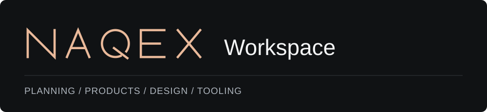
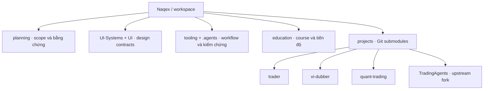
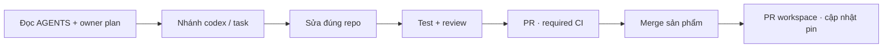

<p align="center"></p>

<p align="center">
  <a href="https://github.com/Naqex/workspace/actions/workflows/workspace.yml"></a>
  <a href="LICENSE"></a>
</p>

Không gian chung để phát triển sản phẩm, nghiên cứu và học trading cùng AI.
Workspace giữ **plan, kiến thức, design contracts và tooling**. Code sản phẩm nằm
trong các repo riêng của [Naqex](https://github.com/Naqex).



## Lấy source

```powershell
git clone https://github.com/Naqex/workspace.git
cd workspace
git submodule update --init -- projects/trader
```

Chỉ cần sản phẩm nào thì khởi tạo sản phẩm đó. Để lấy cả bốn:

```powershell
git submodule update --init -- projects/trader projects/vi-dubber projects/quant-trading projects/TradingAgents
```

Submodule pin **đúng commit**, không tự lấy HEAD mới nhất. Fork tham khảo
`tooling/reverse-skill` chỉ khởi tạo khi cần; giữ upstream và quy tắc riêng.

## Chọn đúng nơi làm việc

| Sản phẩm | Phạm vi | Bắt đầu |
|---|---|---|
| [Naqex Trader](https://github.com/Naqex/trader) | Replay, backtest, journal, analytics và Live MT5 | [README](https://github.com/Naqex/trader#readme) · [Product Plan](planning/trader/PRODUCT-COMPLETION-PLAN.md) |
| [Naqex VI Dubber](https://github.com/Naqex/vi-dubber) | Dịch, phụ đề và lồng tiếng video | [README](https://github.com/Naqex/vi-dubber#readme) · [PLAN](https://github.com/Naqex/vi-dubber/blob/main/PLAN.md) |
| [Naqex Quant Lab](https://github.com/Naqex/quant-trading) | Nghiên cứu định lượng và kiểm chứng offline | [README](https://github.com/Naqex/quant-trading#readme) |
| [TradingAgents](https://github.com/Naqex/TradingAgents) | Fork framework phân tích thị trường bằng agent | [README upstream/fork](https://github.com/Naqex/TradingAgents#readme) |

Mỗi repo giữ dependency, tests, CI và version riêng. Không có launcher chung cho
toàn bộ hệ sinh thái. Replay, research và kiểm tra UI không tự cấp quyền giao dịch.

## Một vòng làm việc



| Cần tìm | Đường dẫn |
|---|---|
| Bản đồ thư mục, commands và cách giao việc cho agent | [Development guide](docs/development/README.md) |
| Context liên project và nguồn tiến độ | [CURRENT-CONTEXT](planning/CURRENT-CONTEXT.md) |
| Quy tắc giữ, compact và archive plan/evidence | [Context lifecycle](planning/CONTEXT-LIFECYCLE.md) |
| Design foundations / trading UI | [UI Systems](UI-Systems/README.md) · [Trading UI](UI/README.md) |
| Tìm code và tài liệu bằng Xerj local | [Search tooling](tooling/search/README.md) |
| Học trading | [Education](education/README.md) |
| CI, version, release và đóng góp | [Contributing](CONTRIBUTING.md) |
| Quyền sử dụng và thương mại | [License](LICENSE) · [Chính sách](docs/licensing.md) |

README chỉ điều hướng. PLAN giữ scope; ledger/checkpoint do PLAN chỉ định giữ
trạng thái và bằng chứng. Các báo cáo có ngày là lịch sử, không tự chứng minh
nghiệm thu hiện tại. Đóng gói và public release ứng dụng được để sang đợt sau.

Mã workspace do Naqex sở hữu theo [Naqex Source Available License](LICENSE):
dùng cá nhân/nghiên cứu theo điều khoản; thương mại cần giấy phép riêng. Các bản
đã phát hành theo MIT giữ quyền đã cấp. Sản phẩm, fork, dữ liệu và tài nguyên bên
thứ ba giữ license/notices riêng; xem [notices](THIRD_PARTY_NOTICES.md).
