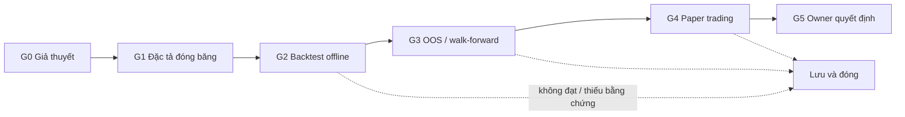

# Quy trình nghiên cứu chiến lược bằng đội AI trong Paperclip

01/11/2026. **Đề xuất vận hành, chưa enforce.** Tài liệu này mô tả cách một ý
tưởng trading đi qua đội agent trong Paperclip. Nó không cấp quyền chạy engine,
broker hay tiền thật. Scope/acceptance vẫn thuộc
[owner plan](../trader/AI-RESEARCH-UI-PROTOTYPE-20261031.md); trạng thái runtime
và bằng chứng thuộc [receipt](../checkpoints/ai-integrations-20261031/RECEIPT.md);
cách chạy Paperclip ở [tooling/paperclip/README.md](../../tooling/paperclip/README.md).
Phân tích vai trò chi tiết: [PAPERCLIP-QUANT-TEAM-RESEARCH-20261031.md](PAPERCLIP-QUANT-TEAM-RESEARCH-20261031.md).

## Hiện trạng đọc được lúc viết

Đọc bằng GET lúc viết, không thay đổi runtime. Đây là snapshot, kiểm lại trước
mỗi lần thao tác.

| Hạng mục | Giá trị quan sát |
|---|---|
| Paperclip | `http://127.0.0.1:17860`, `local_trusted`, commit `e2a9b5e`, health ok, backup tự động bật |
| Company / agents | `Naqex AI`, 1 agent **Trưởng nhóm nghiên cứu**, `codex_local`, model `claude-opus-5.5` |
| Heartbeat agent | `enabled:false`, `maxConcurrentRuns:1`, `maxDailyRuns:6`, `wakeOnDemand:true` |
| Gateway | CLIProxyAPI có listener ở 17852 (Responses API); owner file ghi `running` |
| Engine | Quant Lab có walk-forward/cost stress và paper-soak contract offline; RD-Agent chưa cài; TradingAgents chưa nối |

Hai điểm cần owner xem: agent trưởng nhóm đang mang role `researcher` thay vì
`pm`, và `wakeOnDemand:true` nghĩa là giao task hoặc mention vẫn đánh thức agent
dù timer tắt. Pilot trước cho thấy inference đạt nhưng tool call bị policy chặn;
chưa có lượt nào chứng minh agent tự ghi task/artifact đúng quy trình.

## Vai trò và ranh giới quyền

| Vai trò | Được làm | Không được làm |
|---|---|---|
| Owner (người) | Chốt đề tài, thị trường, risk budget VND, mở holdout, duyệt chuyển bước, quyết định paper/demo/live | — |
| Trưởng nhóm nghiên cứu | Viết đề bài, chia task, theo dõi blocker, tổng hợp báo cáo tiếng Việt cho owner | Sửa kết quả kiểm chứng, đổi tiêu chí/holdout, tự tuyển agent, sửa connection/model/skill |
| Nghiên cứu chiến lược | Viết giả thuyết, đặc tả, code candidate trong vùng được cấp; backtest trên dữ liệu phát triển; ghi mọi lượt thử | Đọc holdout hoặc metric holdout, tự chạy bộ đánh giá cuối, tự đánh dấu “đạt” |
| Kiểm chứng độc lập | Đọc candidate đã đóng băng, chạy bộ đánh giá cố định, kết luận đạt / không đạt / thiếu bằng chứng / lỗi | Sửa candidate, nới tiêu chí, nhận chỉ đạo về kết luận từ trưởng nhóm |

Quan hệ báo cáo trong Paperclip chỉ là hành chính. Tính độc lập phải đến từ
quyền dữ liệu/công cụ: researcher không có đường đọc holdout, kết quả kiểm
chứng do code sinh và có hash. Prompt cấm không thay được quyền API/filesystem.
Bản pin cấp sẵn cho agent chuẩn quyền cấu hình agent/skill/connection
([permission defaults](../../projects/integrations/paperclip/doc/agent-permission-defaults.md)),
nên cần thử một thao tác bị từ chối thật trước khi tạo thêm hai agent.

## Vòng đời một ý tưởng

Mỗi cổng có một người kết luận và một artifact. Kết quả yếu là kết luận hợp lệ;
“thiếu bằng chứng” không được ép thành đạt.

| Cổng | Ai làm → ai kết luận | Tiêu chí đo được để qua |
|---|---|---|
| G0 Giả thuyết | Researcher → trưởng nhóm | Lý do kinh tế/hành vi một đoạn; thị trường, timeframe, baseline (buy-and-hold hoặc null); nguồn dữ liệu và data cutoff; behavioral fit theo [hồ sơ owner](../../projects/quant-trading/AGENTS.md#hồ-sơ-hành-vi-người-vận-hành): tần suất lệnh, chuỗi lỗ dự kiến, profit giveback, mức cần tự quyết |
| G1 Đặc tả | Researcher → kiểm chứng | Quy tắc vào/ra không mơ hồ; vùng tham số định trước (tối đa 3 candidate/đề tài, mỗi biến thể tính một lượt thử); split train/validation/holdout ghi ngày; `dataset_version`, `cost_version`, `risk_version`; số lượt thử tối đa và điều kiện dừng. Đóng băng bằng hash |
| G2 Backtest offline | Researcher chạy → kiểm chứng xác nhận | Tín hiệu đóng cửa ngày `t` chỉ giữ vị thế từ `t+1`; phí và slippage mỗi lần đổi vị thế; CAGR, volatility, Sharpe, max drawdown, turnover, số lần vào lệnh, time in market so với baseline; cùng hash cho ra cùng metric; tối thiểu 20 lệnh đóng và 5 khối ngày UTC, thấp hơn thì là thiếu bằng chứng |
| G3 OOS / walk-forward | Kiểm chứng chạy | Expanding walk-forward, test window không chồng nhau; cost stress có baseline 1.0 và ít nhất 2× phí/slippage; báo tỷ lệ fold có CAGR dương và drawdown xấu nhất; Sharpe kèm tổng số lượt thử và deflated Sharpe; holdout chỉ mở một lần theo lệnh owner. Ngưỡng cụ thể owner chốt trước khi chạy |
| G4 Paper trading | Runner offline → kiểm chứng | Theo [paper-soak contract](../../projects/quant-trading/docs/research/paper-soak-contract-r1-2026-09-28.md): 30–60 ngày UTC, cutoff tăng dần mỗi ngày, reconcile, phí/slippage bằng VND; ít nhất 1 lần restart không sinh intent trùng; receipt luôn `PREP_ONLY_OFFLINE`, `promotion_allowed:false` |
| G5 Quyết định | Trưởng nhóm tổng hợp → owner | Báo cáo một trang: kết quả từng cổng, rủi ro bằng % và VND trên risk budget đã chốt, số lần owner muốn can thiệp trong paper, khuyến nghị tiếp/dừng. Agent chỉ khuyến nghị |

Ngưỡng 20 lệnh/5 khối ngày lấy từ gate R3b đã có
([R3b checkpoint](../trader/R3B-CHECKPOINT-2026-09-19.md)). Đó là sàn phần mềm
để tránh kết luận từ mẫu quá nhỏ, không phải bằng chứng có edge; chiến lược
khung ngày thường cần nhiều lệnh hơn để có ý nghĩa thống kê.

Nếu đã xem holdout rồi sửa candidate, tập đó trở thành dữ liệu nghiên cứu; cần
holdout mới hoặc paper forward. Data split không loại được tri thức tương lai mà
LLM đã học khi pretraining, nên ý tưởng dựa trên tin tức/sự kiện lịch sử phải
ghi rõ giới hạn này.

## Tuyệt đối không tự động

- Kết nối broker/sàn, tạo API key, `OrderSend` hoặc bất kỳ lệnh gửi giao dịch.
  `OrderCheck`/`CHECK_ORDER` hay kiểm kết nối không mở quyền gửi lệnh.
- Tài khoản demo hoặc live, tiền thật, futures, leverage, short ngoài phạm vi lab.
- Mở holdout, đổi tiêu chí cổng, đổi `cost_version`/`risk_version` sau khi đã thấy kết quả.
- Tạo agent, sửa connection/model/skill/policy, bật timer, đổi auth hoặc bật MCP.
- Biến receipt paper thành quyền promotion. Chỉ owner quyết định, ngoài Paperclip.

Đội nghiên cứu không có broker key hay dữ liệu tài khoản. Nếu sau này có bước
demo, quyền gửi lệnh nằm ở một dịch vụ execution riêng có contract và gate riêng.

## Giới hạn chi phí và lượt chạy

| Giới hạn | Giá trị |
|---|---|
| Timer heartbeat | Tắt (`enabled:false`) |
| Đồng thời | `maxConcurrentRuns:1` mỗi agent; 1 job nghiên cứu toàn đội trong pilot |
| Lượt/ngày | `maxDailyRuns:6` mỗi agent (giá trị hiện tại) |
| Retry | Tối đa 2 lần cho lỗi kỹ thuật; kết quả yếu không phải lỗi kỹ thuật |
| Dừng | Hết lượt thử, timeout, thiếu data/tool, lỗi lặp hoặc không có artifact mới thì dừng và báo blocker |

Budget Paperclip dựa trên cost events được báo về. Gateway local có thể không
báo chi phí, nên số tiền 0 không chứng minh không tốn quota; giới hạn lượt thử,
thời gian và số run vẫn là chốt chặn chính. Tắt timer không chặn wake theo yêu
cầu; muốn chặn hẳn thì pause agent.

## Lưu bằng chứng

- Mỗi job ghi `job_id`, `candidate_id`, hash code/dataset/config, data cutoff,
  split, `cost_version`, `risk_version`, seed, engine và model ID, mọi lượt thử
  (kể cả thất bại), metric và đường dẫn artifact.
- Artifact JSON được code validate theo schema. Process exit 0 chỉ là process
  đã xong; câu “đã kiểm chứng” do agent viết không phải bằng chứng.
- Báo cáo nghiên cứu Quant Lab ở `projects/quant-trading/docs/research/`; dữ
  liệu/report tạo lại được để trong `data/raw/`, `reports/` hoặc `.runtime/`,
  không commit. Task Paperclip chỉ chứa tóm tắt và link tới artifact.
- Checkpoint nối vào owner plan và receipt hiện có; không tạo ledger song song.
  Trước thay đổi runtime Paperclip, tạo backup qua API như receipt đã làm.

## Nguồn phương pháp

- Bailey, López de Prado, [The Deflated Sharpe Ratio](https://papers.ssrn.com/sol3/papers.cfm?abstract_id=2460551) (2014): điều chỉnh Sharpe theo số lượt thử và phân phối không chuẩn.
- Bailey, Borwein, López de Prado, Zhu, [The Probability of Backtest Overfitting](https://papers.ssrn.com/sol3/papers.cfm?abstract_id=2326253): đo xác suất chọn nhầm cấu hình do overfit.
- Bailey, Borwein, López de Prado, Zhu, [Pseudo-Mathematics and Financial Charlatanism](https://papers.ssrn.com/sol3/papers.cfm?abstract_id=2308659): thử càng nhiều, backtest đẹp càng dễ là ngẫu nhiên.
- Harvey, Liu, Zhu, [… and the Cross-Section of Expected Returns](https://doi.org/10.1093/rfs/hhv059) (RFS 2016): nâng ngưỡng t-stat khi đã thử nhiều yếu tố.
- White, [A Reality Check for Data Snooping](https://doi.org/10.1111/1468-0262.00152) (Econometrica 2000): kiểm định mô hình tốt nhất trong nhiều mô hình so với baseline.
- Walk-forward đã có trong workspace: [pilot Quant Lab](../../projects/quant-trading/docs/research/walk-forward-cost-stress-pilot-r1-2026-09-28.md).

## Quyết định còn mở cho owner

1. Thị trường và timeframe đầu tiên. Quant Lab hiện là crypto spot D1; MT5/Forex chưa có bộ mô phỏng tương đương.
2. Ngưỡng G3: deflated Sharpe tối thiểu, tỷ lệ fold dương, max drawdown cho phép theo % và VND, mức cost stress phải sống sót.
3. Risk budget VND cho paper và bước sau nếu có, cùng quy tắc không can thiệp lệnh paper giữa kỳ review.
4. Phân quyền thật: đổi role trưởng nhóm sang `pm`, tắt `wakeOnDemand` khi không làm việc, thu grant cấu hình mặc định, qualify tool call trước khi tạo researcher/kiểm chứng.
5. Ai giữ holdout và bộ đánh giá: script do owner chạy, hay agent kiểm chứng có quyền đọc riêng.
6. Mức quota/lượt chạy chấp nhận mỗi tuần khi gateway không báo cost.
7. Engine: chỉ Quant Lab trước, hay qualify thêm RD-Agent (cần Linux/WSL/Docker) và TradingAgents.
