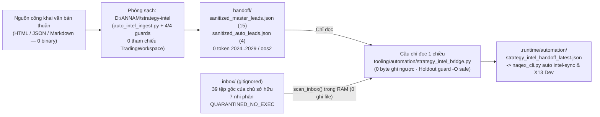

# Đường Ống Phòng Sạch Strategy-Intel & Cầu Đọc Một Chiều (27/11/2026)

**Kết quả chính:** Toàn bộ đường ống cách ly 1 chiều giữa kho phòng sạch `D:/ANNAM/strategy-intel` (nhánh `codex/total-offensive-2`) và `TradingWorkspace` đã hoàn thiện, đạt **`4/4` chốt chặn phòng sạch (`rc = 0`)**, **`0 byte` ghi ngược**, **`0` rò rỉ dữ liệu Holdout `2025+`** (`holdout_rows_analysed = 0`), **`0 VND`**, **`OrderSend = 0`**, và bàn giao sẵn sàng **`4` ứng viên phi-CFD đủ điều kiện sàng lọc Dev (`<= 2024-12-31`)** cho `<X13_WORKER>`.

> **Cấp độ bằng chứng & cảnh báo trung thực:** Toàn bộ ý tưởng thu thập từ bên ngoài mang nhãn cứng **`untrusted_external_data: true`** và **`SOURCE_CLAIM_ONLY`**. Không có bất kỳ chỉ số Winrate, Profit Factor hay Max DD nào từ nguồn web/vendor được công nhận làm bằng chứng nội bộ; mọi ứng viên phải tự kiểm định lại trên dữ liệu Dev (`<= 2024-12-31`) trước khi xem xét bước tiếp theo.

---

## 1. Kiến Trúc Cách Ly Một Chiều (One-Way Air-Gap)

### 4 Rào Chắn Cứng Đã Khóa

1. **Cách ly tuyệt đối tại `strategy-intel`:** Toàn bộ mã nguồn và tệp bàn giao trong `D:/ANNAM/strategy-intel` có **`0` import, `0` đường dẫn đọc, `0` chuỗi tham chiếu** tới `TradingWorkspace` hoặc `private_vault`.
2. **Đọc một chiều không ghi ngược (`writes_back_to_cleanroom = 0`):** Cầu nối [strategy_intel_bridge.py](../../tooling/automation/strategy_intel_bridge.py) nhập trực tiếp hàm `scan_inbox()` từ [inbox_intake_scanner.py](../../tooling/ai-engines/inbox_intake_scanner.py) để quét hoàn toàn trong bộ nhớ RAM (tuyệt đối không gọi CLI vốn sẽ ghi tệp `inbox-triage-report.*` ngược về `strategy-intel`).
3. **Chặn rò rỉ Holdout kép (miễn nhiễm `python -O`):** Tầng Phòng Sạch dùng `holdout_sanitizer.py` xóa sạch mọi chuỗi `2024..2029` / `oos2` và số nguyên `2024..2099` trước khi vào `handoff/`; tầng `TradingWorkspace` dùng [holdout_guard.py](../../tooling/ai-engines/quant_core/holdout_guard.py) (`HoldoutLockError`, không dùng `assert`) quét đệ quy thêm một lớp nữa và từ chối ngay khi phát hiện bất kỳ khóa, chuỗi, ngày ISO `>= 2025-01-01` hoặc năm `2025..2099` nào.
4. **Sửa triệt để lỗi vệ sinh kho (`P0-5`) mà không đụng tệp của chủ sở hữu:** `repo_hygiene_check.py` kiểm định **`0` tệp nhị phân** trên toàn bộ tệp Git đang theo dõi (`git ls-files`) và tệp chưa được gitignore (`git ls-files --others --exclude-standard`), đồng thời liệt kê riêng **`7` tệp nhị phân cục bộ trong `inbox/` (đã gitignore)** ở mức thông tin kiểm kê — không báo lỗi giả, không xóa hay sửa tệp của chủ sở hữu, nhưng vẫn **chặn cứng (`FAIL`)** nếu ai đó cố tình `git add -f` nhị phân hoặc đặt nhị phân ngoài `inbox/`.

---

## 2. Kiểm Toán Kho Hiện Hữu & Luồng Thu Thập Tự Động Mới

### 2.1. Tổng Hợp Kho Dữ Liệu Sạch Hiện Có (Bất Biến)

| Phân vùng | Số lượng | Trạng thái & kết luận kiểm toán |
|---|---:|---|
| **`master_leads.json` / `sanitized_master_leads.json`** | `15` leads | Giữ nguyên bất biến (`SOURCE_CLAIM_ONLY`, `11` đạt 5 tiêu chí nguồn / `4` dưới 100 lệnh). Chỉ `1/15` (`SEA003`) có quy tắc công khai đủ dựng; phát hiện mâu thuẫn phí nguồn (`7 USD/lot` vs `106 USD/lot` tại mức `0,02%/chiều` với vàng `2.650 USD/oz`). |
| **`rejected_log.json`** | `224` mục | `188` chiến lược sập OOS (Nguồn 1) + `18` hồ sơ chưa kiểm định / cảm tính (Nguồn 1) + `4` EA Grid/Martingale độc hại (Nguồn 2) + `14` EA hộp đen không có tài khoản thật kiểm chứng (Nguồn 2). |
| **`indicator_reference.json`** | `27` công cụ | `25` chỉ báo + `2` tiện ích tách riêng, không trộn vào danh mục chiến lược tự động. |
| **`inbox/` cục bộ (quét chỉ đọc trong RAM)** | `39` tệp | `7` tệp nhị phân cách ly `QUARANTINED_NO_EXEC` (`6` `.ex5` + `1` `.rar` `42,8 MB`), `22/25` tệp `.set/.txt` dính cờ đỏ chống quỹ (`MARTINGALE_SET`, `GRID_SET`, `HFT_TICK_EXPLOIT`, `ROLLOVER_WINDOW`), `2` tài liệu PDF, `0` mã nguồn mở sạch. |

### 2.2. Luồng Thu Thập Văn Bản Tự Động (`scripts/auto_intel_ingest.py`)

Đường ống mới chạy hoàn toàn bên trong `D:/ANNAM/strategy-intel` theo chuỗi 4 tầng khép kín:

1. **Chặn tuyệt đối tải nhị phân:** Từ chối ngay trước khi mở kết nối với mọi URL, tham số truy vấn, `Content-Disposition`, `Content-Type`, hoặc chữ ký byte đầu tệp (`MZ`, `PK`, `Rar!`, `7z`, `ELF`, NUL) thuộc nhóm `.ex4/.ex5/.mq4/.mq5/.dll/.exe/.msi/.bat/.cmd/.ps1/.vbs/.zip/.rar/.7z/.tar/.gz/.bin`.
2. **Lưu thô & băm SHA-256:** Ghi bản chụp văn bản/JSON vào `sources/public-auto-ingest/raw/` và tạo `raw_manifest.sha256.json` tương thích hoàn toàn với `verify_verbatim.verify_raw_manifest()`.
3. **Trung thực số liệu (`NOT_DISCLOSED`) & loại cơ chế độc hại:** Mọi trường thiếu trong nguồn gốc (Winrate, PF, Max DD, khung thời gian, quy tắc cắt lỗ nếu nguồn ẩn) bắt buộc ghi nguyên chuỗi `NOT_DISCLOSED` kèm trích đoạn nguyên văn (`verbatim_excerpt`). Các mẫu dính Grid, Martingale, nhồi lệnh trung bình giá, không cắt lỗ (`SL=0`) hoặc HFT latency arbitrage bị đẩy thẳng vào `extracted/auto_rejected_log.json` (`2` mẫu bị loại trong bộ chuẩn hóa offline).
4. **Tẩy sạch Holdout trước bàn giao:** Chỉ `4` ý tưởng sạch đi vào `catalog/auto_public_leads.json` -> lọc qua `scrub_holdout_tokens()` và xác thực trực tiếp bằng `holdout_sanitizer.sanitize_and_validate()` trước khi ghi `handoff/sanitized_auto_leads.json` (`0` chuỗi `2024..2029`/`oos2`, `0` số nguyên `2024..2099`). Hỗ trợ `--offline` (tái lập 100% cho CI) và `--live` (giới hạn số URL, chỉ văn bản thuần).

---

## 3. Đối Chiếu Danh Sách Cấm `§3.4` (`TOP1-SOLO-QUANT-MASTER-PLAN.md`)

Khi cầu đọc một chiều [strategy_intel_bridge.py](../../tooling/automation/strategy_intel_bridge.py) nạp tổng cộng **`19` leads** đã tẩy sạch (`15` master + `4` auto-ingest) và áp dụng đúng danh sách cấm `§3.4`:

| Nhóm kết quả | Số lượng | Chi tiết đối chiếu quy tắc `§3.4` |
|---|---:|---|
| **Bị lọc (`FILTERED_OUT`)** | `15` leads | Toàn bộ `15` leads XAUUSD từ `sanitized_master_leads.json`: **`12` leads** (`D1`/`H4`: `BRK012`, `IND026`, `IND041`, `IND049`, `IND053`, `MTF020`, `NEN006`, `NEN022`, `SEA003`, `SEA004`, `SEA011`, `VIR040`) vướng `FORBIDDEN_S34_CFD_OVERNIGHT_NEG_SWAP` (CFD Vàng qua đêm chịu swap âm trên quỹ, Labs #3A/#3B: `0/21`); **`3` leads** (`H1`: `BRK035`, `MTF016`, `SEA021`) vướng `FORBIDDEN_S34_CFD_INTRADAY_SATURATED` (không gian CFD trong ngày đã bão hòa, Labs #11–#12 & Pass 29–31). |
| **Đủ điều kiện sàng lọc Dev (`ELIGIBLE_FOR_DEV_SCREENING`)** | `4` leads | Toàn bộ từ `sanitized_auto_leads.json` (`SOURCE_CLAIM_ONLY`, `untrusted_external_data: true`, cửa sổ kiểm định nghiêm ngặt `<= 2024-12-31` cho `<X13_WORKER>`): 1. `LEAD-AUTO-QP-TSMOM-01` (`SPY/TLT/GLD`, `D1`, ETF `0` swap, cắt lỗ cứng `2,0x ATR`) 2. `LEAD-AUTO-QP-DUALMOM-02` (`SPY/EFA/AGG`, `W1`, ETF luân chuyển `0` swap, dừng lỗ phòng thủ) 3. `LEAD-AUTO-GH-CRYP-03` (`BTCUSDT/ETHUSDT`, `D1 >= 4H`, Donchian cắt lỗ cứng `2,5x ATR`) 4. `LEAD-AUTO-PUB-VOLCARRY-04` (`TLT/GLD/SHY`, ETF phòng thủ `0` swap — gắn cờ `STOP_LOSS_RULE_NOT_DISCLOSED` & `TIMEFRAME_NOT_DISCLOSED`, bắt buộc khóa thiết kế cắt lỗ trắng trước khi chạy Dev). |

---

## 4. Biên Nhận Cổng Kiểm Chứng (Verification Receipts)

Toàn bộ các cổng dưới đây đã được chạy thực tế và xác nhận **PASS (`rc = 0`)**:

1. **Phòng sạch `D:/ANNAM/strategy-intel` (`4/4` chốt chặn xanh):**
   - `repo_hygiene_check.py`: `PASS (rc = 0)` — kiểm tra `390` tệp tracked + non-gitignored (`0` nhị phân, `0` file nháp), liệt kê riêng `7` tệp nhị phân cục bộ trong `inbox/` (giữ nguyên vẹn, không xóa).
   - `verify_verbatim.py`: `PASS (rc = 0)` — `283/283` SHA-256 Nguồn 1, `48/48` SHA-256 Nguồn 2, `242/242` đối chiếu sâu nguyên văn, `15/15` master leads bất biến, `224` rejected, `27` indicator reference.
   - `holdout_sanitizer.py`: `PASS (rc = 0)` — quét `3` tệp trong `handoff/` (`README.md`, `sanitized_master_leads.json`, `sanitized_auto_leads.json`), `0` rò rỉ `2024..2029`/`oos2`, `100%` hợp lệ schema allowlist.
   - `test_guards.py`: `PASS (rc = 0)` — chạy đầy đủ **`8/8` bài kiểm thử xanh (`0 skipped`)** dưới Python 3.12 có cài `beautifulsoup4`; dưới môi trường MODE_A `.runtime/quant-audit-v24/Scripts/python.exe` (không cài `bs4`), báo trung thực **`7 passed + 1 skipped`** (`test_eafree_fixtures_regression` bỏ qua có chủ đích khi thiếu `bs4`, vẫn `rc = 0`), phủ đủ chặn URL/payload nhị phân, trung thực `NOT_DISCLOSED`, chống lách phủ định chéo cho Grid/Martingale/No-SL, không báo nhầm `SL=0.5`, tẩy sạch Holdout, và tách bạch tracked vs gitignored `inbox/`.
   - Kiểm tra air-gap trên các mã nguồn mới/sửa tại `strategy-intel`: `0` chuỗi tham chiếu `TradingWorkspace` hoặc `private_vault`.
2. **Cầu nối `TradingWorkspace` (CI-safe & `-O` safe):**
   - `ruff check` và `ruff format --check` trên [strategy_intel_bridge.py](../../tooling/automation/strategy_intel_bridge.py) và [test_strategy_intel_bridge.py](../../tooling/ai-engines/tests/test_strategy_intel_bridge.py): `PASS (0 errors, 0 reformats)`.
   - `pytest` (thường) và `python -O -m pytest` trên [test_strategy_intel_bridge.py](../../tooling/ai-engines/tests/test_strategy_intel_bridge.py): `8/8 PASS` ở cả hai chế độ (xác nhận `0 byte` ghi ngược qua ảnh chụp cây thư mục + mtime + SHA-256, chặn cứng rò rỉ `2025/2026`/`oos2` bằng `HoldoutLockError` ngay dưới `-O`, bộ lọc `§3.4` gồm cả mã Crypto ghép `BTCUSDT`/`ETHUSD` và cặp có dấu gạch chéo `XAU/USD`/`EUR/USD`, chống lách phủ định chéo & không báo nhầm `SL=0.5`, và chế độ `--offline` / `--dry-run` an toàn trên CI không có kho phòng sạch).
   - Chạy thực tế `strategy_intel_bridge.py --offline`: xuất `.runtime/automation/strategy_intel_handoff_latest.json` (`status = OK`, `master = 15`, `auto = 4`, `eligible_dev = 4`, `filtered_s34 = 15`, `inbox_quarantined = 7`, `writes_back = 0`); dấu thời gian các tệp trong `D:/ANNAM/strategy-intel` không thay đổi `0 byte`.

---

## 5. Bước Tiếp Theo An Toàn (`0 VND`, Chỉ Chạy Dev `<= 2024-12-31`)

1. Nối `naqex_cli.py auto intel-sync` gọi trực tiếp [strategy_intel_bridge.py](../../tooling/automation/strategy_intel_bridge.py) (chuyển tiếp `--offline`, `--dry-run`, `--json`).
2. Đưa `3` ứng viên `REPLICABLE_FROM_PUBLIC` (`LEAD-AUTO-QP-TSMOM-01`, `LEAD-AUTO-QP-DUALMOM-02`, `LEAD-AUTO-GH-CRYP-03`) vào hàng đợi sàng lọc Dev (`<= 2024-12-31`, `holdout_rows_analysed = 0`) trên `<X13_WORKER>` để đối chứng tương quan `|r| < 0,15` với `PORT_7E`.
