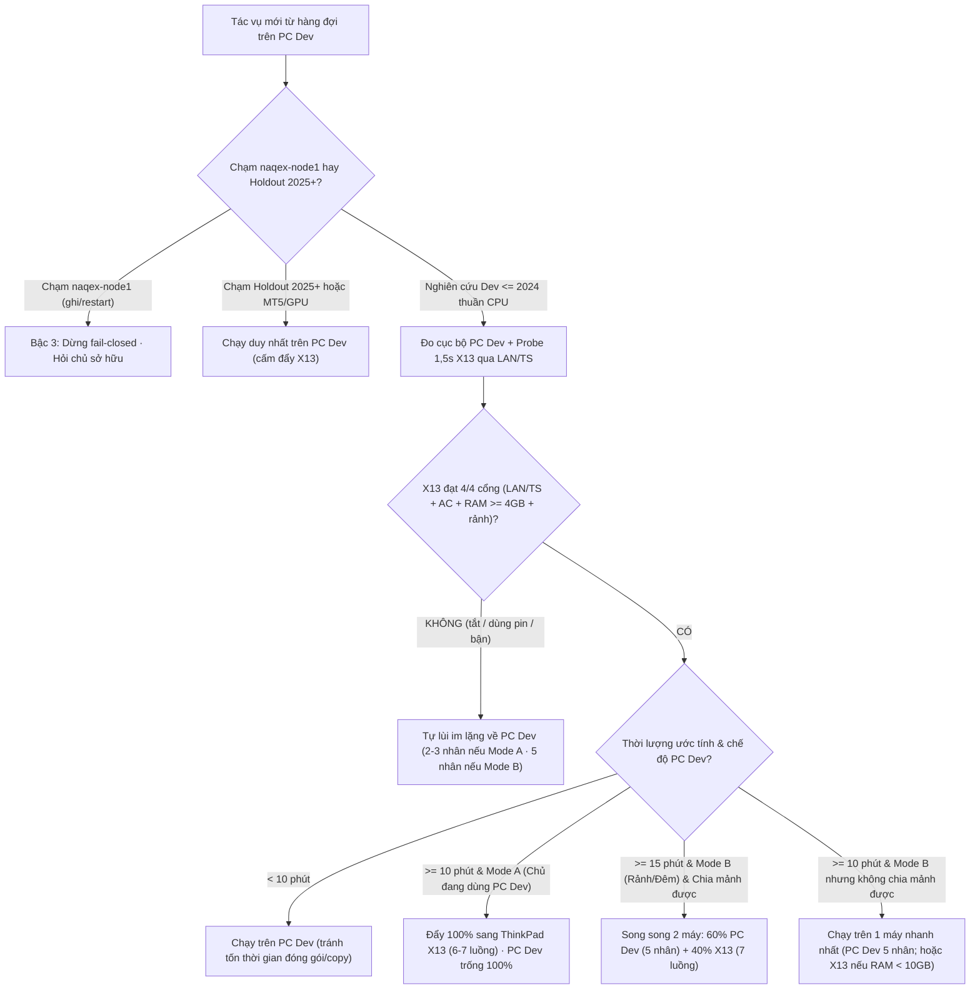
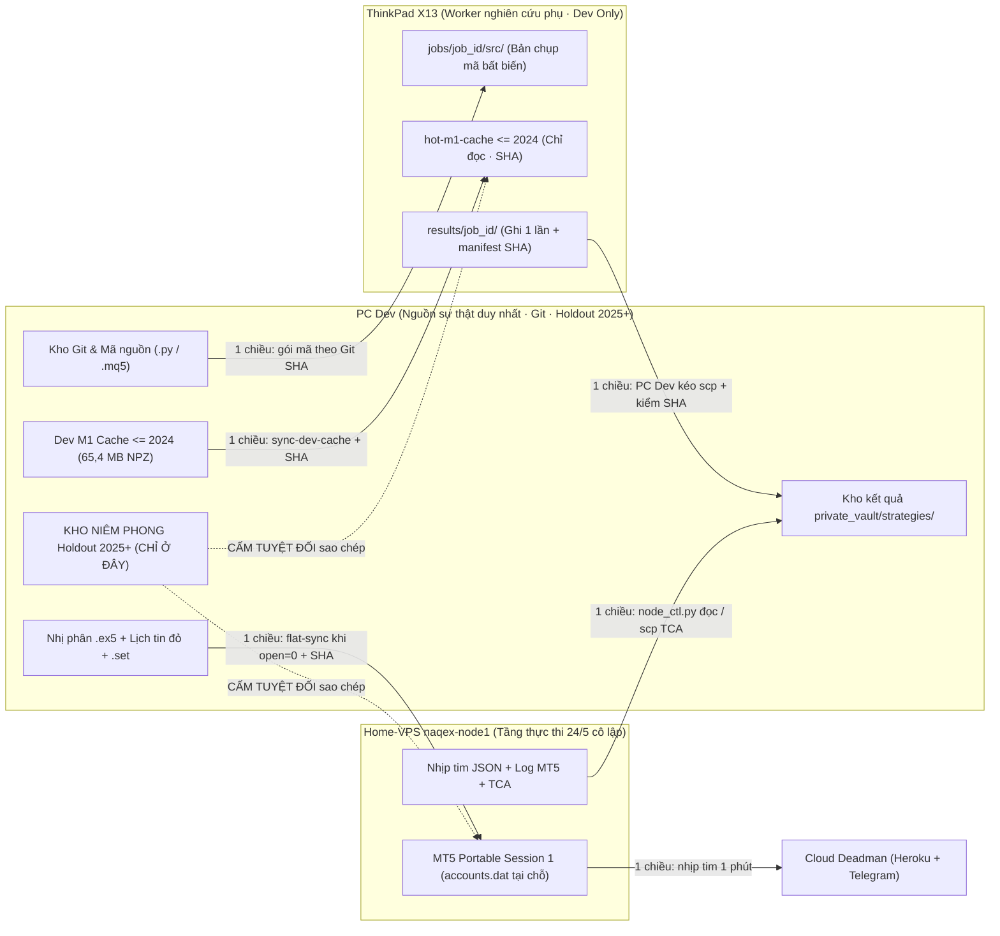

# Kiến Trúc Điều Phối Tính Toán & Đồng Bộ 3 Máy (`PC Dev` · `ThinkPad X13` · `Home-VPS naqex-node1`)

**Kết luận kiến trúc:** Vận hành theo mô hình **Hình Sao 1 trung tâm (`Star Topology`) đặt tại `<DEV_PC>`**, tự phát hiện tải và tự điều phối **không cần hỏi** cho mọi lô nghiên cứu offline (`<= 60 phút`) bằng cổng tiền kiểm `<X13_WORKER>` trong `1,5 giây` (thông LAN/Tailscale + đang cắm sạc AC), giữ **`naqex-node1` cô lập tuyệt đối cho MT5 24/5**, và gói toàn bộ lớp điều phối trong **đúng `1` tệp Python nhẹ (`~250` dòng, `0 VND`, không Redis/Celery/Docker)**.

- **Ngày lập:** `27/11/2026` · **Trạng thái:** `BLUEPRINT_LOCKED_WITH_Q1_POLICY` (chỉ thiết kế kiến trúc Layer-1, chưa sửa mã nguồn).
- **Quyết định chủ sở hữu (`/grill-me Q1` — ĐÃ KHÓA):** Tự phát hiện & tự điều phối **KHÔNG cần hỏi** cho mọi lô offline (`<= 60 phút`, `OrderSend = 0`, `0 VND`): cổng dò `<X13_WORKER>` `1,5s` yêu cầu **thông LAN/Tailscale + đang cắm sạc AC**; `<DEV_PC>` giữ trần **`2–3` nhân `BelowNormal`** khi chủ sở hữu đang dùng/chơi game và mở **`5/6` nhân** khi rảnh `>= 15 phút` hoặc qua đêm; tự chia song song `2` máy cho lô nặng khi cả hai sẵn sàng; **CHỈ hỏi chủ sở hữu trước** khi chạm `naqex-node1`, cần quyền Windows Admin, dùng GPU nặng khi đang chơi game, lô `> 60 phút`, chạm `Holdout 2025+`, hoặc phát sinh chi phí.
- **Ràng buộc an toàn tuyệt đối:** `OrderSend = 0` · `Holdout 2025+ SEALED` (nằm duy nhất tại `<DEV_PC>`, cấm sao chép sang máy khác) · `0 VND` chi phí hạ tầng mới · **OPSEC 2 lớp sạch 100%** (mọi IP thật, tên máy thật, tài khoản SSH/Heroku/Telegram thật nằm riêng trong tệp cục bộ không theo dõi Git tại `private_vault/ops/naqex-node1-topology.md` và `private_vault/ops/naqex-x13-worker.md`).
- **Tương thích công cụ sẵn có:** Khớp 100% với bộ điều khiển đọc `naqex-node1` ([node_ctl.py](../../tooling/ai-engines/ops_cloud/node_ctl.py)), bộ cập nhật phẳng lệnh ([sync_updated_ex5_when_flat.ps1](../../tooling/ai-engines/exports/deployment_kit/vps_kit/sync_updated_ex5_when_flat.ps1)), kiểm tra sức khỏe ([system_doctor.py](../../tooling/ai-engines/system_doctor.py)), và môi trường nghiên cứu Numba đã cài sẵn trên `<X13_WORKER>`.

---

## 0. Tổng Quan Vai Trò & Biên Giới Cứng Của 3 Máy

| Máy (Tên đại diện Layer-1) | Phần cứng & kết nối | Vai trò chính thức | Vùng CẤM tuyệt đối |
|---|---|---|---|
| **`<DEV_PC>`** (Máy làm việc chính) | Intel i5-9400F (`6` nhân / `6` luồng), `32 GB` RAM, GPU `RTX 2070 Super`, Windows 11 | **Trung tâm duy nhất (Control Plane):** làm việc hàng ngày của chủ sở hữu, sửa/commit Git, biên dịch `.ex5`, giữ kho `Holdout 2025+`, chạy lô nhẹ/GPU/chia tải qua đêm | Không để tác vụ nền chiếm GPU khi chủ sở hữu dùng máy; không để đồng hồ trôi `>= 1s` |
| **`<X13_WORKER>`** (ThinkPad X13 Gen 1) | Intel i5-10310U (`4` nhân / `8` luồng), `16 GB` RAM (`15,73 GB` khả dụng), `~237 GB` SSD (`~121 GB` trống), Win 11 Pro · `ssh naqex-x13` (LAN `< 1 ms`) / `ssh naqex-x13-ts` (Tailscale) | **Máy tính toán nghiên cứu phụ:** chạy lô CPU Dev (`<= 2024`), Monte Carlo Numba (`13,56 triệu đường/giây` trên `8` luồng, tải NPZ `65,4 MB` trong `199,4 ms`), thu thập `QUOTE_ONLY` dài giờ khi cắm sạc AC (`Lid Close = Do Nothing`) | **CẤM** `Holdout 2025+`, **CẤM** `accounts.dat`/mật khẩu sàn, **CẤM** chạy khi rút sạc (dùng pin), **CẤM** `git commit/push`, **CẤM** kết nối tới `naqex-node1` |
| **`naqex-node1`** (Home-VPS 24/5) | Windows 10 IoT LTSC 21H2 · `C:` `119 GB` SSD (OS/MT5/Pagefile), `D:` `465 GB` HDD (backup `05:30` lưu `30` ngày), `E:` `111 GB` scratch cáp SATA hỏng · `ssh naqex-node1` / `ssh naqex-node1-ts` | **Tầng thực thi giao dịch cô lập 24/5:** chạy MT5 Portable (`Session 1`, `KeepPrivate=1`), gửi nhịp tim `1` phút lên `<HEROKU_DEADMAN_APP>` (`12 USD/tháng`) + cảnh báo `<TELEGRAM_GUARD_BOT>`, nhận truy vấn chỉ đọc qua `node_ctl.py` (`< 0,5s`) | **CẤM** chạy nghiên cứu/backtest/Monte Carlo, **CẤM** cài AI CLI/Node/Docker/Chrome, **CẤM** `Holdout 2025+`, **CẤM** ghi đè `.ex5` khi còn lệnh mở, **CẤM** đặt MT5/DB/pagefile lên ổ `E:` |

---

## 1. Chính Sách Điều Phối Tải Động (Dynamic Load Policy)

Mục tiêu cốt lõi theo quyết định `/grill-me Q1` đã khóa: **tự điều phối không cần hỏi cho việc offline**, chủ sở hữu luôn cảm thấy `<DEV_PC>` mượt như không có tác vụ nền, pin `<X13_WORKER>` không bao giờ bị đốt khi mang ra ngoài, và tận dụng tối đa sức mạnh cộng gộp của cả `2` máy khi rảnh hoặc ban đêm.

### 1.1. Cảm Biến Nhận Biết Chủ Sở Hữu Trên `<DEV_PC>` (100% Cục Bộ, Không Gián Điệp)

Bộ điều phối **không bao giờ** chụp màn hình, đọc phím bấm hay đọc nội dung cửa sổ. Nó chỉ đọc đúng `4` chỉ số hệ điều hành chuẩn của Windows (`< 60 ms` tổng thời gian đo):

| Chỉ số đo | Cơ chế Windows chuẩn (chỉ đọc) | Ngưỡng xác định **Đang bận (`Mode A`)** | Ngưỡng xác định **Đang rảnh (`Mode B`)** |
|---|---|---|---|
| **1. Thời gian không chạm chuột/phím (`idle_sec`)** | Win32 `user32.GetLastInputInfo` + `kernel32.GetTickCount64` (tránh lỗi tràn `49,7` ngày của bộ đếm 32-bit) | `idle_sec < 900` (`< 15 phút`) ngoài giờ đêm, HOẶC `idle_sec < 300` trong khung đêm | `idle_sec >= 900` (`>= 15 phút`), HOẶC khung đêm **`00:00–07:00 ICT`** kèm `idle_sec >= 300` |
| **2. Tải GPU (`gpu_util_pct`)** | `nvidia-smi --query-gpu=utilization.gpu,memory.used --format=csv,noheader,nounits` | **`gpu_util_pct > 25%`** (chơi game, dựng video, xem video tăng tốc phần cứng) | `gpu_util_pct <= 25%` |
| **3. Ứng dụng toàn màn hình / giải trí (`foreground_busy`)** | `shell32.SHQueryUserNotificationState` (`QUNS_RUNNING_D3D_FULL_SCREEN` / `QUNS_BUSY`) + tên `.exe` cửa sổ tiền cảnh đối chiếu danh sách game/họp | Đang ở chế độ toàn màn hình D3D/game hoặc ứng dụng trong danh sách bảo vệ | `false` |
| **4. Tải CPU & RAM trống (`cpu_util_pct`, `free_ram_gb`)** | Win32 `GetSystemTimes` (cửa sổ `1,0s`) + `GlobalMemoryStatusEx` | `cpu_util_pct >= 30%` HOẶC `free_ram_gb < 6,0 GB` | `cpu_util_pct < 30%` VÀ `free_ram_gb >= 6,0 GB` |

**Hai chế độ vận hành tự động trên `<DEV_PC>`:**

- **Chế độ A — Chủ Sở Hữu Đang Dùng Máy (`MODE_A_OWNER_ACTIVE` — lướt web, YouTube, Codex/IDE, chơi game):**
  - Giới hạn cứng mọi tác vụ nền trên `<DEV_PC>`: **chỉ dùng `2–3` nhân CPU** (`2` nhân nếu đang chơi game/GPU `> 25%`, `3` nhân nếu làm việc văn phòng/IDE; khóa bằng `SetProcessAffinityMask` + `NUMBA_NUM_THREADS` / `OMP_NUM_THREADS` / `pytest -n`), đặt mức ưu tiên tiến trình **`BELOW_NORMAL_PRIORITY_CLASS`** (`0x00004000`, hoặc `IDLE_PRIORITY_CLASS` khi đang chơi game), và **`0%` GPU**.
  - **Luật đẩy tải tự động:** Mọi lô CPU nặng dự kiến **`>= 10 phút`** thuộc phạm vi Dev (`<= 2024`) sẽ tự động đẩy sang `<X13_WORKER>` (nếu X13 đạt cổng tiền kiểm LAN/TS + AC) để `<DEV_PC>` giữ nguyên `100%` độ mượt.
- **Chế độ B — Chủ Sở Hữu Rảnh / Qua Đêm (`MODE_B_IDLE_OVERNIGHT`):**
  - Mở khóa `<DEV_PC>` lên **`5/6` nhân CPU** (luôn chừa `1` nhân cho Windows/SSH/chuột không giật), mức ưu tiên **`NORMAL_PRIORITY_CLASS`** (`0x00000020`), RAM tối đa `24/32 GB`.
  - Nếu lô lớn (`>= 15 phút`, chia mảnh được) và `<X13_WORKER>` đạt cổng tiền kiểm LAN/TS + AC -> tự động kích hoạt **chạy song song `2` máy (`60% <DEV_PC> + 40% <X13_WORKER>`)**.
  - **Tự nhường quyền tức thì (Live Preemption):** Mỗi `30 giây`, bộ điều phối kiểm tra lại `GetLastInputInfo` và `gpu_util_pct`. Nếu chủ sở hữu bất ngờ quay lại máy lúc nửa đêm (`idle_sec < 120` hoặc GPU `> 25%`), bộ điều phối **tự hạ tiến trình con trên `<DEV_PC>` xuống `2–3` nhân + `BELOW_NORMAL` ngay lập tức** mà không hủy lô đang chạy dở.

### 1.2. Cổng Tiền Kiểm `1,5s` & Bảo Vệ Pin Trên `<X13_WORKER>`

Trước khi gửi **bất kỳ** công việc nào sang `<X13_WORKER>`, `<DEV_PC>` chạy `1` lệnh dò ngắn theo đúng thứ tự dự phòng của `node_ctl.py` (**ưu tiên LAN `naqex-x13` `< 1 ms`, tự dự phòng sang Tailscale `naqex-x13-ts`** nếu khác mạng LAN; hỗ trợ thêm cờ `--lan-only` cho lệnh đồng bộ cache nặng `65,4 MB`):

```text
ssh -o BatchMode=yes -o ConnectTimeout=2 naqex-x13 "C:\NaqexResearch\.venv\Scripts\python.exe C:\NaqexResearch\x13_probe.py"
```

*(Thời gian phản hồi thực tế trên LAN `< 1,5 giây`.)*

**4 điều kiện BẮT BUỘC để `<X13_WORKER>` được nhận việc (Fail-Closed):**

1. **Thông mạng LAN hoặc Tailscale ổn định:** SSH `BatchMode=yes` qua `naqex-x13` (hoặc `naqex-x13-ts`) phản hồi JSON hợp lệ trong `<= 2,0s`.
2. **Đang cắm điện lưới AC (`AC_ONLY` — TUYỆT ĐỐI KHÔNG ĐỐT PIN):** Kiểm tra đồng thời `kernel32.GetSystemPowerStatus().ACLineStatus == 1` VÀ `Win32_Battery.BatteryStatus` thuộc nhóm đang cắm sạc (`2` hoặc `6..9`, từ chối ngay khi `BatteryStatus == 1` = đang xả pin). *(Bảo vệ trong lúc chạy: nếu chủ sở hữu rút sạc mang X13 đi khi job đang chạy dở, bộ bọc trên X13 phát hiện `ACLineStatus == 0` quá `60 giây` sẽ tự lưu trạng thái, dừng sạch tiến trình con và báo về `<DEV_PC>` để máy chính chạy nốt).*
3. **Tài nguyên sẵn sàng & không đụng khóa:** CPU đang dùng `< 40%`, RAM trống **`>= 4,0 GB`**, ổ `C:` trống **`>= 15,0 GB`**, và không có tệp khóa `C:\NaqexResearch\locks\active_job.lock` từ lô khác còn sống.
4. **Sạch ranh giới dữ liệu & đồng hồ:** Venv `C:\NaqexResearch\.venv\Scripts\python.exe` tồn tại, độ lệch NTP `< 1.000 ms`, và kiểm tra nhanh `forbidden_files == 0` (không có tệp `holdout`/`2025+`/`accounts.dat`).

**Tự lùi im lặng (Silent Automatic Fallback):** Nếu `<X13_WORKER>` đang tắt máy, đang gập máy ngủ ngoài đường, đang chạy bằng pin, hoặc đang bận lô khác -> bộ điều phối **tự động chuyển việc về chạy trên `<DEV_PC>`** theo đúng trần nhân của Chế độ A (`2–3` nhân `BelowNormal`) hoặc Chế độ B (`5` nhân `Normal`), ghi rõ `fallback_reason` vào tệp JSON biên nhận. **Không báo lỗi đỏ, không làm gián đoạn công việc, không hỏi làm phiền chủ sở hữu.**

### 1.3. Ma Trận Định Tuyến 4 Kịch Bản (`PC Dev` vs `X13` vs `Song Song 60/40` vs `VPS`)



- **Vì sao tỷ lệ chia song song là `60% <DEV_PC> + 40% <X13_WORKER>` (không phải `50/50`)?**
  - CPU desktop i5-9400F (`5/6` nhân, công suất ổn định `65W`, không hạ xung) có tốc độ thực tế trên tải dài `> 10 phút` nhanh hơn khoảng **`1,45–1,55×`** so với laptop i5-10310U (`4C/8T`, giới hạn nhiệt `15W–25W` khi chạy bền). Chia `60/40` giúp hai máy **hoàn thành gần như cùng thời điểm**, tránh cảnh một máy xong sớm ngồi chờ máy kia.
  - Mọi lô chia song song được cắt thành **`10` mảnh nhỏ (`micro-shards`: `6` mảnh cho `<DEV_PC>`, `4` mảnh cho `<X13_WORKER>`)**. Nếu `<X13_WORKER>` bị rút sạc ở phút thứ `12`, `<DEV_PC>` chỉ cần nhặt lại đúng những mảnh X13 chưa kịp hoàn tất — không mất công chạy lại từ đầu.

### 1.4. Chính Sách 3 Bậc Tự Chủ (Đã Khóa Theo `/grill-me Q1`)

| Bậc tự chủ | Hành động của hệ thống | Phạm vi tác vụ áp dụng | Ví dụ thực tế |
|---|---|---|---|
| **Bậc 1 — Tự chạy im lặng (KHÔNG hỏi)** | Chạy ngay, **không hỏi**, ghi log biên nhận JSON | Lô offline Dev (`<= 2024`), unit test, đối chiếu dữ liệu, thời lượng **`< 15 phút`**, `OrderSend = 0`, `0 VND`, giữ đúng trần nhân & cổng AC X13 | Chạy `pytest`, chạy mô phỏng MC `10.000` nhánh (`< 2 phút`), dò trạng thái chỉ đọc `node_ctl.py status`, kéo kết quả đã xong |
| **Bậc 2 — Báo 1 dòng & tự chạy (KHÔNG chờ duyệt)** | Gửi đúng **1 dòng thông báo** (thời gian ước tính + máy chạy) rồi **tự chạy luôn không cần hỏi** | Lô đa nhân qua đêm hoặc chia tải song song `60/40` kéo dài **`15–60 phút`**, không xung đột ứng dụng chủ sở hữu (`Mode B` hoặc đẩy hoàn toàn sang `<X13_WORKER>` cắm sạc), `OrderSend = 0`, `0 VND` | Quét lưới tham số Dev `<= 2024` mất `~30 phút` chia `60% PC Dev + 40% X13`, hoặc thu thập `QUOTE_ONLY` dưới `60 phút` trên X13 |
| **Bậc 3 — Bắt buộc hỏi & chờ duyệt trước** | **Dừng fail-closed (`exit 2`)**, trình rõ lệnh + tác động và chờ chủ sở hữu đồng ý | (1) Mọi thao tác **ghi/cập nhật/restart trên `naqex-node1`**; (2) Mọi lệnh cần quyền **Windows Admin (UAC)** (`w32tm /resync`, tạo Scheduled Task); (3) Lô tính toán dài **`> 60 phút`**; (4) Tác vụ dùng **GPU nặng** khi chủ sở hữu đang dùng/chơi game; (5) Bất kỳ việc nào chạm **`Holdout 2025+`**, phát sinh **tiền (`> 0 VND`)**, hoặc **gửi lệnh sàn** | Chạy `sync_updated_ex5_when_flat.ps1` bản thật lên `naqex-node1`, cài lịch NTP bằng quyền Admin, chạy lô nghiên cứu `3` tiếng xuyên đêm |

---

## 2. Kiến Trúc Đồng Bộ Không Xung Đột Xuyên Suốt 3 Máy

### 2.1. Mô Hình Hình Sao 1 Trung Tâm (`Star Topology`) — Vì Sao Cấm Đồng Bộ 2 Chiều?

Không bao giờ dùng công cụ đồng bộ hai chiều kiểu OneDrive / Google Drive / Syncthing trên thư mục Git hay thư mục kết quả, và không bao giờ `git commit` từ `<X13_WORKER>` hay `naqex-node1`. Đồng bộ hai chiều đa chủ dễ làm hỏng `.git/index`, tạo xung đột tệp khi `2` máy cùng ghi, và có nguy cơ rò rỉ dữ liệu mật (`Holdout 2025+`, `accounts.dat`, khóa SSH) sang sai máy.

Mọi luồng dữ liệu trong Naqex đều **1 chiều tường minh** quanh trung tâm duy nhất `<DEV_PC>`:



### 2.2. Hợp Đồng Đồng Bộ Không Xung Đột Cho Từng Loại Tài Sản

| Loại tài sản | Nguồn sự thật duy nhất (SSOT) | Cơ chế truyền & xác minh | Lý do bảo đảm **0% xung đột** |
|---|---|---|---|
| **Mã nguồn & Git** | `<DEV_PC>` (nút duy nhất được sửa/commit/push) | Đóng gói bản chụp bất biến theo `git_sha` (danh sách allowlist Dev-only) thành `C:\NaqexResearch\jobs\<job_id>\bundle.tar.gz` + SHA-256 trước khi giải nén chỉ đọc trên `<X13_WORKER>` | Khi `<X13_WORKER>` đang chạy `job_001`, chủ sở hữu vẫn thoải mái sửa code và commit tiếp trên `<DEV_PC>` mà không làm đổi code giữa chừng |
| **Nhị phân giao dịch (`.ex5`, `.set`, tin đỏ)** | `<DEV_PC>` (`.runtime/mt5-compiled-ex5/` + `manifest.sha256.json`) | Truyền bằng [sync_updated_ex5_when_flat.ps1](../../tooling/ai-engines/exports/deployment_kit/vps_kit/sync_updated_ex5_when_flat.ps1) (`schema: naqex-ex5-flat-sync-v2`): khóa cứng `terminal_connected == true`, `positions_state == CONFIRMED`, `open_positions == 0`, tuổi nhịp tim `[-60s, +180s]`, xác minh SHA-256 và tự sao lưu `.naqex_sync_rollback_<UTC>/` trước khi ghi | Tự chặn (`exit 2`) nếu có lệnh mở hoặc mất kết nối sàn; xác minh `KeepPrivate=1` trước khi khởi động lại MT5; không bao giờ sao chép `accounts.dat` |
| **Dữ liệu Dev (`<= 2024`) vs `Holdout 2025+`** | `<DEV_PC>` | `sync-dev-cache` chỉ sao chép 1 chiều đúng danh sách trắng: `configs/` (`<= 2024`), `quant_factory/*.py` (loại mọi tệp `holdout*`), và `frozen_9e_tapes_v1.{json,npz}` (`max_utc <= 2024-12-31`). Kiểm tra `binding_sha256`, `npz_sha256`, và **`forbidden_files == 0`** | `Holdout 2025+` (`NATIVE_FTMO_HOLDOUT_LOCK.json`, `.runtime/holdout-m1-cache/`) chỉ tồn tại vật lý trên `<DEV_PC>` — không có đường dẫn nào đẩy ra ngoài |
| **Kết quả tính toán (`Result Artifacts`)** | Thư mục bất biến theo `<job_id>` | `<X13_WORKER>` chỉ ghi vào `C:\NaqexResearch\results\<job_id>\` (gồm dữ liệu đầu ra + `host_meta.json`), và ghi `manifest.sha256.json` ở **bước cuối cùng** làm cờ báo hoàn tất. `<DEV_PC>` chủ động kéo `scp` về `private_vault/strategies/<step>/x13_<job_id>/` và kiểm khớp `100%` SHA-256 | **Hai máy không bao giờ cùng ghi vào một tệp.** `<DEV_PC>` chỉ kéo khi đã thấy `manifest.sha256.json` nên không bao giờ đọc tệp ghi dở; tự dọn trên X13 sau `14` ngày đã nghiệm thu |
| **Log sống & Telemetry** | `naqex-node1` | Chảy 1 chiều lên `<HEROKU_DEADMAN_APP>` (`1` phút/lần) và `<DEV_PC>` kéo chỉ đọc qua `node_ctl.py` / `scp` vào `.runtime/live-overnight/` | Không bao giờ ghi ngược từ `<DEV_PC>` hay `<X13_WORKER>` vào thư mục log/dữ liệu sống của `naqex-node1` |

### 2.3. Đồng Bộ Đồng Hồ, Múi Giờ & NTP Xuyên Suốt Cả 3 Máy

**Vì sao lệch đồng hồ dù chỉ `1–2 giây` (như mức `-1,41s` đo được hôm nay trên `<DEV_PC>`) vẫn gây hại?**

1. **Ranh giới cửa sổ cấm tin đỏ theo UTC:** Quy tắc chặn tin đỏ (`±2 phút` ở The5ers, `±5 phút` ở FTMO) đối chiếu trực tiếp giờ UTC hệ thống với tệp `naqex_red_news_utc.csv`. Đồng hồ lệch làm lệch cửa sổ bảo vệ và làm sai dấu đo độ trễ khớp lệnh trong các sự kiện NFP/CPI (`nfp_cpi_quote_collector.py`).
2. **Sai số đối soát nhịp tim & TCA giữa 3 máy:** `sync_updated_ex5_when_flat.ps1` kiểm tuổi nhịp tim `[-60s, +180s]`, còn Watchdog chặn dấu thời gian tương lai. Nếu `naqex-node1` lệch `-0,061s` trong khi `<DEV_PC>` lệch `-1,41s`, mọi phép so sánh độ trễ vòng lặp giữa hai máy bị cộng sai số giả `1,35 giây`.
3. **Quy chuẩn múi giờ bất di bất dịch:**
   - **Mọi log, CSV, JSON, mã `<job_id>`, lịch tin đỏ, đối soát TCA:** Bắt buộc **100% `UTC`** (`ISO-8601` đuôi `Z` hoặc Unix timestamp UTC).
   - **Múi giờ `ICT` (`UTC+7`) hoặc giờ sàn (Prague/Server):** **CHỈ** dùng để hiển thị cho con người đọc (báo cáo, UI, khung ngủ `00:00–07:00 ICT`) hoặc công thức tính ngày của sàn đã quy đổi rõ ràng từ UTC.

**Chính sách NTP chuẩn cho 3 máy (dùng chung 1 nguồn chuẩn `time.cloudflare.com` + `time.google.com`):**

| Máy | Mục tiêu lệch UTC | Cảnh báo / Chặn | Cách duy trì tự động |
|---|---|---|---|
| **`naqex-node1`** | **`< 100 ms`** *(hiện đạt `-61 ms`)* | Vàng `>= 500 ms` · Đỏ `>= 2.000 ms` | Dịch vụ `w32time` luôn `Running (Automatic)`, `SpecialPollInterval = 900s`, theo dõi mỗi lần gọi `node_ctl.py status` |
| **`<DEV_PC>`** | **`< 1.000 ms`** *(ưu tiên `< 200 ms`; `< 100 ms` khi đo NFP/CPI)* | Cảnh báo `>= 1.000 ms` · Chặn cứng nếu bật `--require-strict-ntp` | Sửa ngay lệch `-1,41s` hôm nay bằng `1` lần chạy lệnh Admin bên dưới + lịch `SYSTEM` tự chạy mỗi `6 giờ` (`Naqex_NTP_Sync_6h`) |
| **`<X13_WORKER>`** | **`< 1.000 ms`** *(ưu tiên `< 200 ms`)* | Từ chối nhận job nếu `>= 1.000 ms` khi bật `--require-strict-ntp` | Cấu hình cùng bộ máy chủ NTP + lịch `SYSTEM` `Naqex_NTP_Sync_6h` khi thức máy/cắm sạc; `x13_probe.py` kiểm `w32tm /stripchart` trước mỗi job |

**Lệnh chuẩn hóa NTP 1 lần trên `<DEV_PC>` (và `<X13_WORKER>`) — thuộc Bậc 3 (chủ sở hữu tự chạy trong PowerShell quyền Admin, mất `< 1 phút`):**

```text
sc.exe config w32time start= auto
net start w32time
w32tm /config /manualpeerlist:"time.cloudflare.com,0x9 time.google.com,0x9" /syncfromflags:manual /reliable:YES /update
w32tm /resync /force
w32tm /stripchart /computer:time.cloudflare.com /samples:2 /dataonly
schtasks /Create /TN "Naqex_NTP_Sync_6h" /SC HOURLY /MO 6 /RU SYSTEM /RL HIGHEST /F /TR "w32tm /resync /nowait"
```

---

## 3. Kế Hoạch Triển Khai Tối Giản: Đúng `1` Công Cụ `compute_router.py`

Không dựng Redis, không Celery, không Docker, không Kubernetes, không tiến trình chạy ngầm ăn RAM. Toàn bộ lớp điều phối được gói gọn trong **đúng `1` tệp Python chuẩn tại `tooling/ai-engines/ops_cloud/compute_router.py` (`~250` dòng)** theo đúng phong cách tối giản, fail-closed của [node_ctl.py](../../tooling/ai-engines/ops_cloud/node_ctl.py) (`135` dòng) và `1` tệp dò cố định siêu nhẹ `C:\NaqexResearch\x13_probe.py` (`~60` dòng) trên `<X13_WORKER>`.

### 3.1. Giao Diện 5 Lệnh CLI Cốt Lõi

| Lệnh CLI | Mục đích & thời gian chạy | Cổng an toàn bắt buộc |
|---|---|---|
| `python tooling/ai-engines/ops_cloud/compute_router.py probe [--lan-only]` | Quét trạng thái `<DEV_PC>` (`idle_sec`, GPU, fullscreen, CPU, RAM, NTP) + gọi `x13_probe.py` qua `naqex-x13` LAN -> dự phòng `naqex-x13-ts` Tailscale (`< 1,5s` LAN / `< 2,5s` tổng) | Chỉ đọc (`OrderSend = 0`); X13 mất mạng/tắt máy trả `reachable: false` sạch, không văng ngoại lệ |
| `python tooling/ai-engines/ops_cloud/compute_router.py route --est-minutes 25 --ram-gb 4 --shardable` | Chạy `probe` rồi áp bảng luật tất định `/grill-me Q1` để trả về kế hoạch chạy (`DEV_PC_ONLY` / `X13_ONLY` / `PARALLEL_60_40` / `BLOCKED_NEEDS_APPROVAL`), số nhân/luồng và bậc tự chủ (`TIER_1..3`) | Chặn cứng mọi cờ `--touches-holdout` khỏi X13; trả `TIER_3_ASK_OWNER` nếu `--touches-vps`, `--requires-admin`, hoặc `est_minutes > 60` |
| `python tooling/ai-engines/ops_cloud/compute_router.py dispatch --job-id <ID> --entry <SCRIPT> --est-minutes <N> [--shardable] [--shards 10] [--dry-run]` | Đóng gói mã Dev-only bất biến theo `git_sha`, phân mảnh nếu chạy song song `60/40`, chạy với trần nhân/ưu tiên chuẩn, có vòng giám sát preemption `30s` trên `<DEV_PC>` và bảo vệ rút sạc AC trên `<X13_WORKER>` | Kiểm tra chống chèn ký tự shell (kế thừa `_FORBIDDEN_SHELL_META` và allowlist regex từ `node_ctl.py`); kiểm `active_job.lock`; hỗ trợ `--dry-run` |
| `python tooling/ai-engines/ops_cloud/compute_router.py sync-dev-cache [--lan-only] [--dry-run] [--verify-only]` | Nhân bản 1 chiều mã Dev (`quant_factory/*.py`), `configs/` (`<= 2024`), và `frozen_9e_tapes_v1.{json,npz}` sang `C:\NaqexResearch\` qua `scp` | Chỉ cho phép danh sách trắng `<= 2024`; từ chối ngay nếu phát hiện chuỗi cấm (`holdout`, `2025`, `2026`, `accounts.dat`, `id_ed25519`); xác minh `binding_sha256` & `npz_sha256` sau khi chép |
| `python tooling/ai-engines/ops_cloud/compute_router.py pull-results --job-id <ID> --dest <LOCAL_DIR> [--cleanup-remote]` | Kéo thư mục bất biến `C:\NaqexResearch\results\<job_id>\` về `<DEV_PC>` (mặc định `private_vault/strategies/<step>/x13_<job_id>/`) và đối chiếu SHA-256 từng tệp | Từ chối kéo nếu chưa thấy `manifest.sha256.json` (job chưa kết thúc nguyên tử); chỉ báo `VERIFIED_PASS` khi `100%` tệp khớp SHA-256 |

### 3.2. Lược Đồ JSON Chuẩn (`probe` + `route` Output Contract)

```json
{
  "schema": "naqex-compute-router-v1",
  "owner_policy_ref": "grill_me_q1_locked",
  "checked_utc": "2026-11-27T01:30:00Z",
  "order_send_count": 0,
  "dev_pc": {
    "mode": "MODE_A_OWNER_ACTIVE",
    "idle_sec": 42,
    "in_overnight_window_ict": false,
    "gpu_util_pct": 38,
    "fullscreen_busy": false,
    "cpu_util_pct": 19.4,
    "free_ram_gb": 18.6,
    "ntp_offset_ms": -84.2,
    "ntp_ok": true
  },
  "x13_worker": {
    "ssh_alias": "naqex-x13",
    "transport": "LAN",
    "probe_ms": 480,
    "reachable": true,
    "ac_online": true,
    "battery_status_code": 2,
    "battery_pct": 80,
    "cpu_util_pct": 4.1,
    "free_ram_gb": 11.4,
    "disk_free_gb": 120.7,
    "active_job_lock": null,
    "ntp_offset_ms": -65.0,
    "forbidden_files": 0,
    "eligible": true,
    "ineligible_reasons": []
  },
  "decision": {
    "target": "X13_ONLY",
    "autonomy_tier": "TIER_2_NOTIFY_1LINE",
    "ask_owner_required": false,
    "fallback_used": false,
    "fallback_reason": null,
    "dev_pc_cores": 0,
    "dev_pc_priority": "BELOW_NORMAL",
    "dev_pc_gpu_allowed": false,
    "x13_threads": 7,
    "shard_split_pct": {"dev_pc": 0, "x13_worker": 100},
    "reasons": [
      "PC Dev ở Mode A (owner active, gpu_util=38% > 25%)",
      "Ước tính 25 phút >= 10 phút và phạm vi Dev <= 2024",
      "X13 đạt đủ 4/4 cổng (LAN 480ms, AC=true, RAM trống 11,4 GB, 0 tệp cấm)"
    ]
  },
  "guardrails": {
    "holdout_airgap_enforced": true,
    "vps_compute_forbidden": true,
    "strict_ntp_passed": true
  }
}
```

### 3.3. Bảy Cổng An Toàn Bắt Buộc (Fail-Closed Safety Gates)

1. **`ORDER_SEND_CAPABLE = False` & `ORDER_SEND_COUNT = 0`:** Khẳng định tĩnh ngay đầu tệp như `node_ctl.py`; không nhập bất kỳ thư viện đặt lệnh sàn nào.
2. **Cách ly tuyệt đối `Holdout 2025+`:** Mọi đường dẫn chứa `holdout`, `2025`, `2026`, `NATIVE_FTMO_HOLDOUT_LOCK`, `accounts.dat`, `.ssh`, `private_vault` bị chặn cứng cả ở đầu đẩy (`<DEV_PC>`) lẫn đầu kiểm tra (`x13_probe.py`).
3. **Cách ly tuyệt đối `naqex-node1`:** Danh sách đích tính toán của `compute_router.py` chỉ gồm `DEV_PC` và `X13_WORKER` — **không có nhánh mã nào gửi công việc tính toán tới `naqex-node1`**.
4. **Chống tiêm lệnh Shell:** Kế thừa nguyên vẹn bộ lọc `_FORBIDDEN_SHELL_META`, `_SAFE_HOST_RE`, `_SAFE_EXTRA_ARG_RE` từ `node_ctl.py` (mọi lệnh SSH đều gọi `subprocess.run` dạng mảng tham số, `shell=False`).
5. **Khóa bảo vệ pin X13 (`AC_ONLY`):** Cả trước lúc gửi lẫn mỗi `60s` trong lúc chạy; rút sạc là lưu trạng thái và dừng gọn, tự chuyển mảnh còn lại về `<DEV_PC>`.
6. **Xác minh nguyên tử SHA-256 hai đầu:** Mã nguồn đẩy đi có `bundle_manifest.sha256.json`; kết quả kéo về có `manifest.sha256.json` ghi sau cùng. Thiếu manifest hoặc lệch `1` byte là đánh `FAILED_INTEGRITY`, tuyệt đối không nhập vào `private_vault/strategies/`.
7. **Khóa OPSEC 2 lớp:** Không ghi cứng bất kỳ IP nội bộ, Tailscale IP, tên người dùng Windows hay tên ứng dụng cloud nào trong mã nguồn — chỉ dùng bí danh SSH (`naqex-x13`, `naqex-x13-ts`) đã cấu hình sẵn trong `~/.ssh/config`.

### 3.4. Lộ Trình Triển Khai Gọn (Tổng ~75–90 Phút Khi Được Duyệt)

1. **Bước 1 — Chốt đồng hồ NTP trên `<DEV_PC>` (`~5 phút`, cần quyền Admin của chủ sở hữu):** Chạy `6` dòng lệnh chuẩn hóa `w32tm` ở Mục 2.3 để xóa ngay độ lệch `-1,41s` hôm nay xuống `< 100 ms` và bật lịch tự đồng bộ mỗi `6 giờ`.
2. **Bước 2 — Cài đặt `compute_router.py` + `x13_probe.py` + kiểm thử đơn vị (`~50–60 phút`):** Tạo `tooling/ai-engines/ops_cloud/compute_router.py` (`~250` dòng), `tooling/ai-engines/tests/test_compute_router.py` (giả lập đầy đủ Mode A/B, rút sạc AC -> lùi im lặng, chặn Holdout, chặn ký tự shell, kiểm SHA kéo kết quả), và triển khai `x13_probe.py` (`~60` dòng) lên `C:\NaqexResearch\`.
3. **Bước 3 — Diễn tập thực tế & kiểm tra hệ thống (`~15–20 phút`):** Chạy `probe` -> `route` -> `sync-dev-cache --verify-only` -> chạy thử `1` lô Numba MC `5 giây` trên `<X13_WORKER>` -> `pull-results` kiểm khớp `100%` SHA-256 -> xác minh `system_doctor.py --mode fast` PASS toàn bộ.

---

**Bước tiếp theo duy nhất cho chủ sở hữu (`< 2 phút`):** Chạy `6` dòng lệnh NTP quyền Admin ở Mục 2.3 trên `<DEV_PC>` để đưa độ lệch `-1,41s` về `< 100 ms`, rồi xác nhận **"Duyệt triển khai `compute_router.py`"** nếu muốn mở bước viết mã và kiểm thử.
