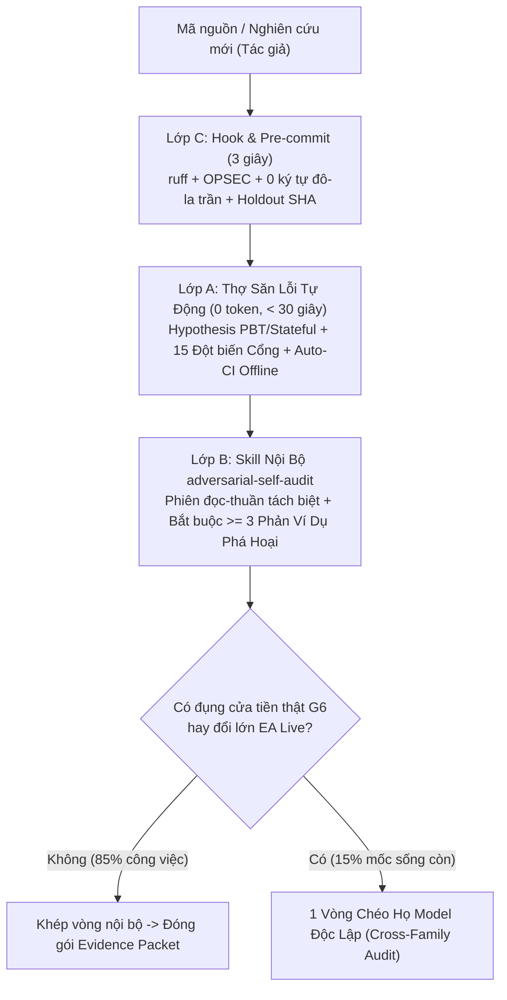

# Kiểm Toán Khoảng Trống Toàn Diện: Naqex TradingWorkspace vs Chuẩn Top 1% Thực Tế (Hệ Thống Quant & Kỹ Thuật AI-Agent 2025–2026)

> **Câu hỏi trọng tâm của chủ sở hữu:** *"Ngoài các chỉ số lợi nhuận Top 1%, Naqex TradingWorkspace thực sự đang thiếu gì trên MỌI khía cạnh — từ kiến trúc hệ thống giao dịch, đa dạng hóa, thống kê, dữ liệu, đến cách vận hành AI-agent, kiểm thử và dòng tiền?"*
>
> **Khóa an toàn & phân tầng bằng chứng:**
> - **Bất biến:** `Holdout 2025+ SEALED` (`holdout_rows_analysed = 0`) · `OrderSend = 0` · **`0 VND`** · Chỉ đọc toàn bộ mã nguồn hiện có · Tách sạch Layer-1 (không IP riêng, không tài khoản cá nhân, không mật khẩu/token).
> - **Phân định nguồn rõ ràng:** `T1` = Nguồn chính thức (kho GitHub, tài liệu gốc, bài báo khoa học bình duyệt, bài kỹ thuật chính hãng Anthropic/OpenAI); `W` = Số liệu đo trực tiếp trong mã nguồn & báo cáo Naqex ngày `27/11/2026`; `R` = Khuyến nghị thực dụng thiết kế riêng cho mô hình **1 người + đội AI Agents trên 3 máy** (`PC Dev` + `ThinkPad X13 worker` + `Home-VPS Windows 10 IoT LTSC`), tuyệt đối nói **KHÔNG** với rác hạ tầng doanh nghiệp.

---

## 0. Tóm Tắt 60 Giây: Sự Thật Thẳng Thắn Cho Chủ Sở Hữu

Naqex đã vượt xa **`90%+`** nhà giao dịch cá nhân và các hệ thống "AI vibe-coding" ngoài thị trường ở **kỷ luật chống tự lừa**: niêm phong Holdout bằng mã băm SHA-256, đo trên dữ liệu M1 Bid/Ask thật, giữ kỷ luật `swap = 0`, có khiên bảo vệ `Naqex_PropGuard.mqh`, có `1.870` ca kiểm thử xanh và `System Doctor` 10/10.

**Tuy nhiên, ngoài việc chưa có `>= 12` tháng chạy tiền thật rút về, Naqex đang thiếu ĐÚNG 5 NỀN TẢNG CỐT LÕI để chạm chuẩn Top 1% thực tế (và không có cái nào giải quyết được bằng cách tinh chỉnh thêm tham số cho `PORT_7E`):**

1. **Thiếu nhánh lợi nhuận không tương quan đang vận hành thật:** `60%` tháng khô hạn ở pha Funded (`8` tháng đói trung vị, chờ rút tiền đầu tiên trung vị `265` ngày) là **lỗ hổng cấu trúc của 1 họ chiến lược duy nhất** (intraday CFD `swap = 0` trên 4 mã liên đới), không phải lỗi chọn tham số. Naqex đã nghiên cứu các nhánh lệch pha (Crypto Spot, Funding Carry, Macro ETF) nhưng đang để nằm kho.
2. **Đang phải đóng "thuế 2 ngôn ngữ" quá đắt (Python ↔ MQL5) & thiếu TCA hậu khớp sâu:** Toàn bộ Bước 1–7 vừa qua tốn hàng nghìn dòng mã pháp y chỉ để chứng minh Python khớp MQL5. Đồng thời, hệ thống đã đo spread/trượt giá lúc vào lệnh (`tca_reconcile.py`, `prop_live_tca_monitor.py`) nhưng **`0` module đo đường cong Markout sau khớp lệnh** (`+1s / +10s / +60s / +5m` so với giá giữa) và chưa tự động đối soát sao kê sàn định kỳ hàng ngày.
3. **Thiếu 3 cổng chống học vẹt cấp tổ chức trong `eval_pipeline.py`:** Đã có DSR, BH-FDR, Random-Entry Monte Carlo và Tail Correlation, nhưng kiểm tra trực tiếp cho thấy **`0` mã nguồn cho PBO (CSCV), CPCV (Purged/Embargoed CV), và White's Reality Check / Hansen's SPA**; công thức DSR hiện tại vẫn dùng phương sai giả định `1/(T-1)` thay vì phương sai thực nghiệm của cả tập thử nghiệm.
4. **Kho mã và kho thí nghiệm bị phân mảnh dù đã xây sẵn công cụ:** Hiện có **`390` tệp `.py` rời** nằm ngay gốc `tooling/ai-engines/` và **`487` tệp (~`609 MB`) rải rác qua `11` thư mục bước** trong `private_vault/strategies/` với định dạng JSON tự phát mỗi đợt. Trong khi đó, module sổ cái SQLite nối chuỗi băm `tooling/run_registry/store.py` (`848` dòng) đã viết xong nhưng có **`0` chỗ gọi** trong toàn bộ `tooling/ai-engines/`.
5. **Thiếu hàng rào tự động săn "lỗi PASS im lặng" để thay `80–90%` các vòng kiểm toán Astra bên ngoài:** Lý do Astra Vòng 1–11 vẫn bắt được hơn `40` lỗi thật dù Naqex có `1.870` bài test là vì môi trường Python chưa cài `hypothesis`, `mutmut`, `ruff`, chưa có `.pre-commit-config.yaml`, CI `.github/workflows/workspace.yml` chỉ chạy danh sách gõ tay **`12/238`** tệp pytest, và `red_team_auditor.py` chỉ kiểm chuỗi lợi suất chứ không tấn công trực tiếp vào dòng mã, biên `NaN`/`Inf`, dấu phí hay máy trạng thái mất kết nối.

---

## 1. Giải Phẫu Hệ Thống Quant Mã Nguồn Mở Top 1% (`T1`) & Bài Học Thực Tế Cho Naqex

### 1.1. So sánh 8 hệ thống mã nguồn mở hàng đầu theo từng lớp kiến trúc

| Hệ thống (`T1`) | Lớp cốt lõi & Kiến trúc | Điểm làm nên chuẩn **Top 1% vận hành** | **NÊN học thẳng cho Naqex** (`R`) | **KHÔNG nên bê vào (tránh phình to)** |
|---|---|---|---|---|
| **NautilusTrader** (`nautechsystems/nautilus_trader`) | Động cơ sự kiện **Rust + Python (PyO3)** (`NautilusKernel`) | **Một mã chiến lược duy nhất** chạy y hệt từ Backtest sang Live; `ExecutionManager` tự đối soát vị thế sàn khi khởi động theo nguyên tắc **fail-closed** (mất báo cáo = cấm chạy, không tự coi là phẳng). | **Mẫu kiến trúc số 1** cho các nhánh ngoài MT5 (Crypto Spot / Carry / Own-Book). Đáng chú ý: `nautilus-trader` **đã được ghim sẵn** trong `projects/trader/foundation_v2/engine_runtime/uv.lock` (`W`). | Không cố ép viết lại `PORT_7E` đang chạy MT5 sang Nautilus (MT5 không có adapter gốc sạch bằng MQL5 cho Prop Firm). |
| **QuantConnect LEAN** (`QuantConnect/Lean`) | Khung tách 5 lớp **C# / Python** | Tách cứng 5 vai trò (*Universe → Alpha → Portfolio → Risk → Execution*), `IBrokerageModel` đóng gói trọn bộ phí/trượt giá/ký quỹ từng sàn, và **chạy song song 1 bản Backtest OOS trên chính dữ liệu Live** để phát hiện lệch giữa lý thuyết và sàn ngay lập tức. | **Chạy đối chứng song song tự động (*Live vs Shadow Replay*)** hàng ngày để phát hiện sai lệch ngay từ lệnh thứ 1, thay vì đợi gom 14 ngày mới ngồi truy vết tay. | Không dựng cả hệ thống LEAN Docker/C# nặng nề chỉ để thay cụm Numba gọn `0,28s` hiện có. |
| **Microsoft Qlib + RD-Agent(Q)** (`microsoft/qlib`, `microsoft/RD-Agent`) | Kho dữ liệu Point-in-Time + Vòng lặp R&D bằng LLM | Dữ liệu **đúng thời điểm (*Point-in-Time*)** chặn rò rỉ tương lai; vòng lặp *Research (giả thuyết) → Development (viết code) → Feedback (chạy đo)* có lập lịch ngân sách thử nghiệm (*Multi-Armed Bandit*) và lưu mọi thí nghiệm có cấu trúc. | Đã học đúng tinh thần ở `knowledge/topics/ai-quant-engineering-frontier-2026.md` (`W`); cần bổ sung **bảng theo dõi ngân sách thử nghiệm `M` tích lũy tự động** vào DB thí nghiệm. | Không cài cả cụm PyTorch/LightGBM/Qlib server cho `7–12` tài sản FX/CFD (Qlib sinh ra cho rổ `300–5.000` cổ phiếu). |
| **Freqtrade** (`freqtrade/freqtrade`) | Bot Crypto Python (nến OHLCV + FreqUI + FreqAI) | Vận hành thực dụng cho cá nhân: dry-run liền mạch, quản trị trạng thái lệnh bền vững trên SQLite, điều khiển/cảnh báo Telegram gọn, tự kiểm tra lookahead (`lookahead-analysis`). | Ý tưởng **công cụ kiểm tra lookahead tự động** (chạy so khớp tín hiệu trên chuỗi cắt ngắn `t` so với chuỗi đầy đủ `T` để bắt lỗi nhìn trộm tương lai) áp thẳng cho mọi nhánh mới. | Không cần bê nguyên khung bot Crypto Freqtrade khi Naqex đã có `projects/quant-trading` và `NautilusTrader` ở `foundation_v2`. |
| **Hummingbot** (`hummingbot/hummingbot`) | Khung Market Making & Arbitrage bất đồng bộ (Python/Cython) | Quản lý sâu sổ lệnh L2 (*order book*), tỷ lệ khớp lệnh chờ (*fill ratio*), hủy/đặt lệnh nhanh và kiểm soát tồn kho chéo sàn. | Chỉ học bộ chỉ số **Maker Fill Ratio & Adverse Selection** nếu sau này kích hoạt lại nhánh Crypto Maker Stat-Arb (`Lab #2B`). | Không lao vào HFT/Market Making cạnh tranh độ trễ mili-giây với quỹ chuyên nghiệp. |
| **Jesse** (`jesse-ai/jesse`) | Khung nghiên cứu & chạy Crypto hướng định tuyến (*route-based*) | API thiết kế chặt để khó viết nhầm lookahead đa khung thời gian; tách sạch trạng thái chỉ báo theo từng tuyến mã/khung. | Chuẩn hóa hợp đồng dữ liệu đa khung thời gian sạch (tránh lỗi đóng băng nến D1/M1 giữa broker và Python từng gặp ở `F06`). | Không dùng hệ thống thương mại hóa phần live của Jesse. |
| **VectorBT** (`polakowo/vectorbt`) | Quét nghiên cứu ma trận hóa (**NumPy + Numba**) | Quét hàng nghìn tổ hợp trong vài giây trên CPU nhờ vector hóa + Numba JIT — lý tưởng cho sàng lọc ban đầu, nhưng không có vòng lặp sự kiện khớp lệnh sống. | Naqex đã xây dựng đúng triết lý này trong `quant_factory/` (`0,28s` nạp `.npz` + `9 ms` Numba JIT, `W`). Giữ nguyên sức mạnh này cho khâu sàng lọc nhanh! | Tuyệt đối không dùng kết quả vector hóa làm bằng chứng khớp lệnh cuối (phải đi qua mô phỏng sự kiện M1/Real-Tick). |
| **ArcticDB & DuckDB** (`man-group/ArcticDB`, `duckdb/duckdb`) | Kho chuỗi thời gian phiên bản hóa (Man Group) & CSDL phân tích SQL nội tiến trình | **ArcticDB** cho phép "du hành thời gian" đúng bản chụp dữ liệu tại thời điểm cũ; **DuckDB** là "SQLite cho dữ liệu phân tích" — chạy SQL trực tiếp trên tệp `.parquet` hàng GB mà **không cần bật server**. | **DuckDB (`1` thư viện Python, `0` server) + Parquet + SQLite (`run_registry`)** là tổ hợp hoàn hảo cho Solo Builder trên 3 máy: truy vấn lịch sử hàng nghìn thí nghiệm và hàng triệu dòng tick trong tích tắc. | Không cần dựng cụm ArcticDB + S3/MongoDB khi tổng dữ liệu M1 của Naqex mới ~`627 MB`. |

---

### 1.2. Năm trụ cột vận hành tách biệt Top 1% khỏi "backtest đẹp trên giấy"

#### (1) Dữ liệu đúng thời điểm (*Point-in-Time*) & Truy xuất nguồn gốc dữ liệu
- **Chuẩn Top 1% (`T1`):** Mọi tập dữ liệu thị trường, lịch tin kinh tế, bảng phí và thông số hợp đồng đều có dấu thời gian hiệu lực (`known_at`), mã băm bất biến và khả năng tái dựng lại *chính xác thế giới đã biết tại ngày quá khứ đó*. Không ai được phép sửa đè tệp cũ rồi ghi đè kết quả lịch sử.
- **Đối chiếu Naqex (`W`):** Naqex đã làm rất tốt ở lớp dữ liệu giá M1 (`hot-m1-cache`, mã băm `NATIVE_FTMO_HOLDOUT_LOCK.json` `f0a6b43cb205535b`, `frozen_9e_tapes_v1.npz`). **Khoảng trống còn lại:** dữ liệu **lịch tin đỏ Dev (`2018–2024`) chỉ có sự kiện USD** (thiếu 5 đồng tiền còn lại như Astra `R2-05` đã chỉ ra), và các tập dữ liệu giá/thí nghiệm chưa được khóa phiên bản tập trung (giống cơ chế manifest nhẹ của `DVC` hoặc bảng `datasets` trong `DuckDB`/`SQLite`) nên nhiều script cũ vẫn đọc đường dẫn cứng khác nhau.

#### (2) Một động cơ duy nhất từ Backtest ra Live & Cơ chế đối soát tự động fail-closed
- **Chuẩn Top 1% (`T1`):** Như `NautilusTrader` (`NautilusKernel`) và `LEAN`, cùng một lớp logic chiến lược chạy cho cả Backtest lẫn Live; chỉ tráo đổi duy nhất lớp cổng kết nối (*DataClient / ExecClient*). Khi khởi động lại hoặc rớt mạng, `ExecutionManager` đối chiếu thẳng vị thế thật trên sàn và **cấm giao dịch (*fail-closed*)** nếu báo cáo sàn bị thiếu hoặc mơ hồ.
- **Đối chiếu Naqex (`W`):** Vì Prop Firm bắt chạy MT5, Naqex buộc phải duy trì **hai bản viết lại hoàn toàn bằng 2 ngôn ngữ** (`Python` nghiên cứu vs `MQL5` thực thi). Hệ quả đo được rất rõ: toàn bộ **Bước 1 → Bước 7** phải đổ lượng công sức khổng lồ vào việc truy vết từng xu sai khác (từ lỗi `Pass27` rơi ngầm Swing, khác biệt `tv_loss` đóng băng trong Tester, khác biệt công thức cỡ lệnh `B1`, tới `92` deal lệch vị trí ở `P1`). Ở tầng vận hành, sau Astra `R2-03`, Naqex đã siết trạng thái mất kết nối — nhưng vẫn chưa có một vòng đối soát tự động *mỗi tối* so sánh **sao kê đóng lệnh của sàn (MT5 statement) vs Nhật ký `naqex_exec_audit.csv` vs Bản chạy lại Python trên chính dữ liệu ngày đó**.

#### (3) Phân tích chi phí thực thi (TCA) chuyên sâu: Đường cong Markout, Fill Ratio & Chọn lọc bất lợi
- **Chuẩn Top 1% (`T1`):** Các bàn quant chuyên nghiệp không chỉ nhìn con số "trượt giá trung bình" mà đo trọn **4 tầng TCA**:
  1. **Slippage so với giá giữa (*Arrival Midprice*):** tách riêng chi phí vượt spread khỏi trượt giá do tốc độ khớp và biến động.
  2. **Đường cong Markout (*Markout Curve*):** theo dõi giá giữa dịch chuyển sau khi khớp lệnh ở các mốc `+1s`, `+10s`, `+60s`, `+5m`, `+15m`. Nếu ngay sau khi mua mà giá liên tục tụt, chiến lược đang bị **chọn lọc bất lợi (*adverse selection*)** hoặc vào muộn sau cú giật thanh khoản; nếu giá đi tiếp đúng hướng, cú trượt giá lúc vào là chi phí tiếp nhận dòng thông tin thật.
  3. **Tỷ lệ khớp (*Fill Ratio*) & Tỷ lệ lệnh bị từ chối/bỏ lỡ:** đo xem bao nhiêu phần trăm cơ hội bị mất do `MaxSpread`, làm tròn `< 0,01` lot, ký quỹ, hay lỗi `retcode` sàn.
  4. **Đối soát tự động sao kê sàn:** khớp từng mã `ticket/order/deal`, hoa hồng, và **swap** (đảm bảo `swap = 0,00` thực tế).
- **Đối chiếu Naqex (`W`):** Naqex đã có nền tốt (`tca_reconcile.py` đo trượt giá theo `% R0` và độ trễ `p90`; `prop_live_tca_monitor.py` có Bootstrap 95% CI + Page CUSUM phát hiện trôi trượt giá trên dữ liệu `5s`). **Tuy nhiên**, lệnh kiểm tra mã nguồn (`rg -i "markout" tooling/ai-engines/quant_factory/`) trả về **`0` kết quả**: chưa có tính toán đường cong Markout sau khớp lệnh, mới đo trên **`28` lệnh Demo FTMO** (`0` lệnh The5ers, `0` lệnh IC Funded), và đối soát sao kê sàn (`prop_challenge_tracker.py`) vẫn là công cụ chạy tay từng đợt chứ chưa nối thành luồng đối chiếu tự động hàng ngày.

#### (4) Đa dạng hóa cấu trúc đa nhánh — Giải mã vì sao `PORT_7E` bị **`60%` tháng khô hạn ở Funded**
- **Toán học nền tảng (`T1` — Rob Carver, *Systematic Trading*, 2015):**
  Một chiến lược đơn lẻ không bị học vẹt ngoài đời thường chỉ đạt `Sharpe` khoảng `0,5–1,2`. Muốn đạt `Sharpe 2,0–3,0` ổn định ở cấp Top 1%, quỹ lớn **không cố tinh chỉnh 1 chiến lược lên `Sharpe 3,0`**, mà ghép `N` nhánh **độc lập về bản chất kinh tế** (tương quan `rho` gần `0`) kèm định cỡ theo độ biến động (*Volatility Targeting*). Công thức hệ số nhân đa dạng hóa (*Diversification Multiplier*):
  `Sharpe_danh_muc = Sharpe_don_le * sqrt( N / (1 + (N - 1) * rho) )`
  - Nếu `N = 7` động cơ nhưng cùng chung một cơ chế biến động (`rho_hieu_dung` cao trong mùa thị trường đi ngang như năm `2023`), lợi ích làm phẳng bị chặn trần sớm.
  - Nếu ghép **`3` họ chiến lược hoàn toàn khác bản chất** (`rho ~ 0,00..0,05`), mỗi họ chỉ cần `Sharpe ~1,1–1,2`, danh mục tổng tự động nhảy lên **`Sharpe ~1,9–2,1`** mà **không cần tăng thêm 1% đòn bẩy nào**.
- **Bằng chứng trực tiếp trong dữ liệu Naqex (`W`):**
  - Trong báo cáo `MULTI-FIRM-CAPITAL-PROMO-OPTIMIZER-20261126.md` (`FTMO 2-Step Standard 100K`, `C10_NEWS_ON`, ma sát `1,00x`): `PORT_7E` có `Sharpe = 1,23`, `Calmar = 0,86`, `Max DD = 8,62%`, dẫn tới **`60%` số tháng Funded không có payout** (`P50 = 8` tháng đói, `P95 = 23` tháng đói) và trung vị chờ lần rút tiền đầu lên tới **`265` ngày** (~`8,7` tháng; không điều kiện `494` ngày).
  - Nguyên nhân gốc: dù có `7` động cơ, **cả 7 đều là họ giao dịch trong ngày `swap = 0` trên 4 mã CFD có liên hệ vĩ mô** (`USDJPY x3`, `US100 x2`, `GBPUSD x1`, `EURJPY x1`). Khi biến động phá vỡ trong ngày của FX/US100 cạn kiệt (điển hình năm `2023` chỉ loanh quanh hòa vốn), cả 7 động cơ cùng chậm lại một lúc.
  - Chính các thí nghiệm `Labs #11–#12` (`0/36` ứng viên đậu) đã chứng minh **không gian CFD intraday `swap = 0` đã gần chạm biên Pareto** — ép thêm động cơ cùng họ hoặc vặn lại tham số chỉ làm tăng nguy cơ học vẹt.
  - Ngược lại, chính nghiên cứu `CRYPTO-SLEEVE2-AND-QUANT-POD-STUDY-20261123.md` và `QUANT-POD-4SLEEVE-ALLOCATION-20261124.md` của Naqex đã chứng minh **ghép nhánh ngoài Prop** (Crypto Spot Trend `r = +0,02`, Funding Rate Carry, Macro ETF 18 năm `r = -0,0155`) đưa danh mục lên **`Sharpe 1,91–2,25`, `Calmar 2,09–2,43`, `MaxDD 2,45%`**. Khoảng trống lớn nhất hiện nay là **mọi nhánh ngoài Prop này mới chỉ nằm trên báo cáo offline** (Crypto Shadow trên `naqex-node1` đã tạm tắt ở Vòng 3, Own-Book bị hoãn dưới `10k USD`), khiến thực tế vận hành vẫn đang đặt `100%` trứng vào 1 họ duy nhất!

#### (5) Kiểm định thống kê chống học vẹt cấp tổ chức (`DSR`, `PBO`, `CPCV`, `White RC` & `Hansen SPA`)
- **Chuẩn Top 1% (`T1`):**
  1. **Deflated Sharpe Ratio — DSR** (*Bailey & López de Prado, JPM 2014*): nâng ngưỡng chuẩn từ `0` lên mức Sharpe tối đa kỳ vọng do ăn may khi thử `M` biến thể, đồng thời điều chỉnh theo độ lệch (*skewness*) và đuôi dày (*kurtosis*) của lợi suất.
  2. **Probability of Backtest Overfitting — PBO qua CSCV** (*Bailey, Borwein, López de Prado & Zhu, JCF 2014/2017*): chia lịch sử thành `S` khối đối xứng, ghép mọi tổ hợp trong mẫu / ngoài mẫu để tính **xác suất chiến lược đứng hạng nhất trong mẫu bị tụt xuống dưới trung vị ngoài mẫu** (`PBO > 0,50` = báo động học vẹt nặng).
  3. **Combinatorial Purged Cross-Validation — CPCV** (*López de Prado, Advances in Financial Machine Learning, 2018*): loại bỏ các điểm tập huấn luyện có nhãn chồng lấn thời gian với tập kiểm tra (*Purging*) và đặt vùng đệm ngay sau tập kiểm tra (*Embargoing*) để chặn rò rỉ do tương quan nối tiếp — đặc biệt quan trọng cho chiến lược giữ lệnh nhiều ngày (Crypto Spot, ETF, Carry).
  4. **White's Reality Check (2000) & Hansen's SPA Test (2005):** kiểm định bootstrap toàn cục hỏi *"Có thực sự tồn tại ít nhất 1 chiến lược thắng mốc chuẩn sau khi đã thử cả nghìn biến thể không?"*; bản **Hansen SPA** chuẩn hóa phương sai (*studentized*) nên không bị các biến thể rác làm méo p-value như White RC đời đầu.
- **Đối chiếu mã nguồn Naqex (`W`):**
  - **Đã có rất tốt:** `eval_pipeline.py` có `deflated_sharpe_ratio`, `benjamini_hochberg` (BH-FDR), `sign_flip_p_numba`, `tail_correlation_report`; `robustness_gate.py` có Random-Entry Monte Carlo, tách riêng BUY/SELL, cắt Top 5% lệnh thắng và xếp hạng theo năm xấu nhất; `live_decay_monitor.py` có CUSUM + Wald SPRT + Confidence Cone.
  - **Khoảng trống xác minh trực tiếp:**
    1. Lệnh tìm kiếm toàn bộ `tooling/ai-engines/quant_factory/` cho **`PBO` / `CSCV` / `CPCV` / `White Reality Check` / `Hansen SPA` trả về `0` kết quả**.
    2. Trong `eval_pipeline.py` (dòng `88`), `deflated_sharpe_ratio` hiện đang ước lượng độ lệch chuẩn của các thử nghiệm dưới giả thuyết không bằng công thức gần đúng `sqrt(1 / (t - 1))` thay vì nhận **phương sai thực nghiệm của toàn bộ mảng Sharpe đã thử** (`var_sr_trials`) theo đúng công thức gốc Bailey & López de Prado (2014).
    3. Toàn bộ kiểm định hiện tại mới dừng ở **nghiên cứu quá khứ (Dev `2018–2024` + 1 lần Holdout offline `2025–2026` trước khi sửa sang `v1.01`/`C10_NEWS_ON`) + `28` lệnh Demo**, còn khoảng trống **`0` tháng tiền thật đã rút** so với chuẩn `>= 12` tháng của Top 1%.

---

## 2. Kỹ Thuật AI-Agent, Vibe-Coding, Skills & Kiểm Thử Chuẩn 2025–2026 — Và Kế Hoạch Thay Thế Các Vòng Astra

### 2.1. Các đội kỹ thuật AI-Agent hàng đầu thế giới (2025–2026) đang làm gì khác phần còn lại? (`T1`)

Tổng hợp từ các công bố kỹ thuật chính thức của **Anthropic** (*Building Effective Agents*, *Demystifying Evals for AI Agents*, *Claude Code Hooks*) và **OpenAI** (*Harness Engineering* với Codex), điểm phân biệt người dùng AI nghiệp dư với nhóm Top 1% **không nằm ở việc viết prompt dài hơn**, mà ở **thiết kế khung kẹp kiểm chứng (*Harness Engineering*)**:

1. **Tách rạch ròi Quy tắc Cứng (*Hooks / Code*) khỏi Lời Nhắc (*Markdown*):**
   - *Anthropic Claude Code Best Practices:* Những hướng dẫn cần cân nhắc để ở `AGENTS.md` / `CLAUDE.md` (giữ gọn `< 200` dòng để tránh phình ngữ cảnh). Mọi **quy tắc cấm tuyệt đối không ngoại lệ** (cấm chạm Holdout, cấm để ký tự đô-la trần, cấm lộ OPSEC, tự chạy định dạng/lint/test) bắt buộc chuyển sang **Hook hoặc Script chặn cứng (`exit 2`)** nằm ngoài ngữ cảnh LLM — vì LLM luôn có xác suất quên luật khi phiên dài.
2. **Chống bẫy "AI tự viết code rồi tự viết test dễ để tự chấm đậu":**
   - *OpenAI Harness Engineering:* Khi agent viết cả mã nguồn lẫn bài test, agent rất dễ viết test kiểu lặp lại đúng công thức bị sai hoặc nới lỏng ngưỡng kiểm tra. Nhóm Top 1% khóa chặt bằng 4 lớp:
     - **Bắt buộc test lỗi trước khi sửa (*Fail-before-Fix*)** cho mọi bản vá lỗi.
     - **Gói bằng chứng kiểm chứng được (*Verifiable Evidence Packets*):** mã băm tệp, đúng câu lệnh, mã thoát, nhật ký thô (Naqex đã làm rất tốt điểm này!).
     - **Tách riêng Agent Kiểm Toán Độc Lập chỉ đọc** (không chung lịch sử suy luận với tác giả) + **bộ kiểm tra chuẩn khóa ngoài phạm vi tác giả**.
     - **Đo độ ổn định đa lượt (`pass^k`)** thay vì ăn may 1 lần (`pass@k`), và chấm cả **dấu vết thực thi (*transcript/state outcome*)** chứ không chỉ đọc đoạn tóm tắt cuối cùng (Anthropic *Demystifying Evals*).
3. **Bộ tứ vũ khí kiểm thử công nghiệp cho mã tài chính Python:**
   - **Kiểm thử theo bất biến (*Property-Based Testing* — `Hypothesis`):** Thay vì chỉ gõ tay 5 ví dụ đẹp, ta khai báo *quy luật toán học bất biến* (ví dụ: tổng `Đậu + Rớt + Chờ == 100%` với mọi tổ hợp tham số; phí không bao giờ nhận `NaN`/`Inf`/âm; thêm vốn không làm sụt vô lý nếu cùng luật; tỷ giá tăng làm giảm `tick_value` theo đúng chiều). `Hypothesis` tự sinh hàng trăm đầu vào quái đản và tự thu gọn lỗi về ví dụ tối giản nhất.
   - **Kiểm thử máy trạng thái (*Stateful Testing* — `Hypothesis RuleBasedStateMachine`):** Cho máy tự tạo chuỗi ngẫu nhiên các sự kiện `mở lệnh → khớp một phần → mất kết nối → qua nửa đêm Prague → khởi động lại VPS → đóng lệnh` và kiểm tra sau **mọi bước** xem có bao giờ vi phạm trần rủi ro `SYMCAP`, mất mốc ngày hay cho phép đồng bộ `.ex5` khi chưa phẳng hay không!
   - **Kiểm thử đột biến (*Mutation Testing* — `mutmut` hoặc bộ tiêm đột biến AST có chọn lọc):** Tự động bẻ gãy mã nguồn gốc (`<` thành `<=`, `+` thành `-`, đảo dấu trượt giá, xóa điều kiện chặn `None`) rồi chạy lại bộ test. Nếu bộ test vẫn báo **XANH**, nghĩa là test đang bị rỗng (*mutant survived*) — vạch mặt ngay các lỗi "PASS im lặng"!
   - **Đối chiếu nhà tiên tri độc lập (*Independent Oracle & Golden Snapshot*):** So kết quả hàm Numba/MQL5 tối ưu với một hàm Python ngây thơ, ngắn 20 dòng tính tay trên cùng tập mẫu đóng băng, đảm bảo không copy cùng 1 lỗi sang cả code lẫn test.

---

### 2.2. Giải phẫu thẳng thắn: Vì sao Astra Vòng 1–11 vẫn bắt được hơn `40` lỗi dù Naqex đã có `1.870` bài test & `red_team_auditor.py`? (`W`)

Đây là phát hiện quan trọng nhất khi đối chiếu trực tiếp lịch sử repo (`ASTRA-INDEPENDENT-REDTEAM-AUDIT`, `ASTRA-ROUND2`, `STEP6`, `STEP7`, và kiểm định Vòng 11):

- **Nguyên nhân sâu xa:** Hai công cụ phản biện nội bộ hiện có (`quant_factory/red_team_auditor.py` và `quant_factory/research_council.py`) thực chất là **bộ kiểm tra áp lực thống kê lên chuỗi lợi suất đã sinh ra sẵn** (nhân phí `1x..3x`, bỏ top 5% lệnh thắng, kiểm DSR/BH-FDR). Chúng **không hề tấn công vào dòng mã nguồn, miền đầu vào dị thường, hay máy trạng thái vận hành**.
- **5 nhóm lỗi lặp đi lặp lại xuyên suốt 11 vòng Astra mà bộ test `1.870` ca đã bỏ lọt:**

| Nhóm lỗi ẩn (`W`) | Ví dụ thực tế đã bị Astra bắt tại trận | Tại sao `1.870` bài test cũ vẫn báo XANH? |
|---|---|---|
| **1. Lỗi `PASS` im lặng (*Fail-Open*)** | `evaluate_prop_challenge` trả `PASS_TO_PAID` với `4` lệnh vào `0` lệnh đóng (`R2-01`); bộ thu thập NFP/CPI nhận `OTHER_EVENT` qua `startswith` và nhận gói `1` giây `1` tick (`R10/R11`); probe Demo cấp đạt `Core7` khi chỉ có deal vệ tinh `S6` (`R11`); `history_deals_get() is None` không bị coi là lỗi (`R11`). | Test cũ chỉ kiểm tra luồng đẹp (*happy path*), không tiêm dữ liệu giả mạo, dữ liệu rỗng, `None`, hay dữ liệu thiếu pha để ép hàm phải trả **FAIL**. |
| **2. Bẫy dấu, phí, đơn vị & kế toán** | Ngược dấu trượt giá lệnh đóng `SELL` (`-5 bps` thay vì `+10 bps` bất lợi, `R2-01`); bật `own_book` lãi `+8%` không rủi ro cho `P3/P4/P5` nhưng tắt cho `P1/P2` (`B3`); trừ dòng tiền chiết khấu vào dòng tiền không chiết khấu (`#401`); tính phí rút lên tiền hoàn thẻ (`B6`); dùng tìm kiếm nhị phân trên hàm không đơn điệu (`B5`). | Không có kiểm thử bất biến kinh tế (*invariants*) độc lập (ví dụ: trượt giá bất lợi của cả BUY và SELL khi khớp xấu hơn giá báo đều phải `> 0`; mọi bảng so sánh chính sách phải giữ cố định biến nền `ceteris paribus`). |
| **3. Lỗi máy trạng thái & đồng thời** | Nhánh mất kết nối vẫn xuất `open_positions = 0` khiến `sync_updated_ex5_when_flat.ps1` có thể thay `.ex5` khi sàn vẫn còn lệnh (`R2-03`); đua lệnh `SYMCAP` giữa 2 EA (`F02/R2-02`); rò rỉ biến khi `OnDeinit` (Bước 4); mất tick cùng mili-giây (`Step 7.2`) và khe hở ảnh chụp cùng mili-giây (`R11`). | Không có `Hypothesis RuleBasedStateMachine` xáo trộn thứ tự sự kiện *disconnect / partial-fill / timeout / same-ms burst / restart*. |
| **4. Điểm mù biên, `NaN`/`Inf` & múi giờ** | `load_pricing_catalog` lọt giá `NaN`/`Inf` và ngày tương lai `2099` (`R11`); bộ thu thập chỉ đọc không chặn `trade_allowed == True` (`R11`); lệch biên `48h` UTC vs Server (`R11`); đọc mốc đậu `P2` tại `18:00` khi còn lệnh mở thay vì `22:55` khi phẳng (`R11`); biên `5%/10%` (`<` vs `<=`). | Thiếu bộ sinh dữ liệu biên tự động (`NaN`, `Inf`, `±0,01`, ngày quá khứ/tương lai, tuần lệch DST Mỹ–Âu). |
| **5. Kiểm tra bề mặt & lỗ hổng CI** | `mql5_parity_checker.py` quét tên hàm/ký tự trong file nên vẫn `PASS` dù Python và MQL5 khác hệ số rủi ro và cách dựng nến (`F01/F06`); `.github/workflows/workspace.yml` chỉ chạy danh sách gõ tay **`12/238`** tệp pytest (`W`), bỏ sót cả `test_prop_capital_promo_optimizer.py` lẫn `test_nfp_cpi_quote_collector.py`; môi trường chưa cài `hypothesis`, `mutmut`, `ruff`, không có `.pre-commit-config.yaml`. | Thiếu kiểm thử đột biến (`mutmut`) để chứng minh checker sẽ kêu đỏ khi hành vi lệch, và CI chưa tự khám phá các bộ test offline mới thêm. |

---

### 2.3. Thiết kế "Bộ Kiểm Toán Red-Team Đối Kháng Nội Bộ" 3 Lớp (Thay `80–90%` Vòng Astra) (`R`)

Thay vì tiếp tục phụ thuộc vào việc chép prompt gửi kiểm toán ngoài cho từng bước nhỏ, Naqex nên thể chế hóa vĩnh viễn một **Khung Phản Biện 3 Lớp** ngay trong repo:

- **Lớp A — Thợ Săn Lỗi Tự Động (`0` token LLM, chạy mọi lúc):**
  1. **Bộ kiểm thử bất biến & máy trạng thái (`Hypothesis`):** Gắn ngay vào `5` điểm nóng sống còn: `prop_pricing_catalog` (bơm `NaN`/`Inf`/âm/ngày `2099`), `prop_capital_promo_optimizer` (kiểm `Pass+Fail+Pending == 100%`, đơn điệu vốn, không lệch `own_book`), `prop_challenge_tracker` (bơm `0` exit, ngược chiều SELL, thiếu statement), `nfp_cpi_quote_collector` (bơm `trade_allowed=True`, `1` tick, cùng mili-giây, lệch NTP), và máy trạng thái `PropGuard/FlatSync` (disconnect + partial fill + restart).
  2. **Bộ Kiểm Định Đột Biến Có Chọn Lọc (*Targeted Gate Mutation Suite*):** Không chạy `mutmut` lên toàn bộ `390` file (rất chậm), mà chỉ chạy trên **~10 hàm cổng quyết định** (*gate/loader/comparator/accounting*). Tiêm `15–20` đột biến có chủ đích (đổi `<` thành `<=`, đảo dấu SELL, trả `None` từ MT5 API, lùi 1 thanh lookahead, xóa check phẳng vị thế) — nếu bộ test vẫn xanh -> **chặn ngay**!
  3. **CI Tự Khám Phá:** Thay danh sách cứng `12` tệp trong `.github/workflows/workspace.yml` bằng gắn nhãn `@pytest.mark.offline` để mọi tệp test offline mới thêm đều tự động chạy trên GitHub Actions.
- **Lớp B — Skill Vĩnh Viễn `.agents/skills/adversarial-self-audit/SKILL.md`:**
  - Chạy bởi một agent **khởi tạo sạch hoàn toàn**, quyền **chỉ đọc**, tách biệt với tác giả.
  - **Luật Phản Chứng Bắt Buộc (*Falsification-First*):** Agent verifier **không được phép** ghi chữ `PASS` nếu chưa tự chạy trong RAM (stdin/script tạm không sửa repo) ít nhất **`3` ca phá hoại thực tế** nhằm cố lừa hệ thống trả `PASS` giả, quét trọn **Checklist 7 Lớp Lỗi (rút từ Astra R1–R11)**:
    1. *Fail-Open / Spoof:* Đầu vào thiếu pha, `0` lệnh đóng, chỉ có vệ tinh, API trả `None`.
    2. *Dấu, Phí & Kế Toán:* Ngược dấu BUY/SELL, phí thẻ vs hoàn thẻ vs rút lãi, chiết khấu đồng nhất.
    3. *Biên & Miền Giá Trị:* `NaN`, `Inf`, `0`, `-0,01/+0,01`, ngày tương lai/quá hạn, làm tròn `0,01` lot.
    4. *Thời Gian & Múi Giờ:* `UTC` vs `Server` vs `Prague` vs `NY`, tuần lệch DST, cùng mili-giây.
    5. *Máy Trạng Thái & Lỗi Hạ Tầng:* Mất mạng, `trade_allowed=True`, khớp một phần, khởi động lại giữa phiên.
    6. *Thống Kê & Mẫu Số:* Đủ `TB / Trung vị / P(<=0)`, không nhị phân trên hàm không đơn điệu, đúng mẫu số Funded, tổng `Đậu+Rớt+Chờ == 100%`.
    7. *Tái Tính Từ Tệp Thô:* Tự đối chiếu ít nhất 1 bảng trọng yếu từ `.htm`/`.csv.gz`/`.json` gốc, không tin bảng Markdown tóm tắt.
- **Lớp C — Hook Cứng & Giữ Đúng Chỗ Cho Kiểm Toán Chéo Họ Model:**
  - Đưa toàn bộ luật không ngoại lệ (`ruff`, OPSEC, `0` ký tự đô-la trần, Holdout SHA) vào `.pre-commit-config.yaml` và `system_doctor.py`.
  - **Trung thực về giới hạn:** Lớp A + B + C sẽ triệt tiêu **`80–90%`** số lỗi mà Astra R1–R11 từng phải nhặt tay. Với **`10–20%`** quyết định có rủi ro mất tiền thật (mở cổng chi tiền `G6`, hoặc thay đổi lớn trên EA tiền thật), **vẫn nên giữ 1 vòng kiểm toán chéo họ model độc lập** vì hai họ LLM khác nhau có điểm mù tư duy khác nhau.

---

## 3. Bảng Điểm 6 Trụ Cột Thẳng Thắn: Naqex Workspace vs Top 1% Thực Tế (Chuẩn Luật 15)

### 3.1. Điểm neo chiến lược lõi `PORT_7E` hiện tại (để đặt 6 trụ cột vào đúng ngữ cảnh tiền thật)

*Cấp độ bằng chứng (`W`): Backtest trên dữ liệu quá khứ Dev `2018–2024` (`DAILY_APPROX`, `Cluster B` đã xem) + `28` lệnh đo sống trên FTMO Demo (`0,66x`) — **CHƯA phải Holdout mù cho bản `C10_NEWS_ON`, CHƯA có tháng tiền thật đã rút về ngân hàng.** Ví dụ neo chuẩn: `FTMO 2-Step Standard 100K` (`C10_NEWS_ON`, ma sát `1,00x`, phí BF `478,68 USD` ~ `12,6 tr VND` cả phí thẻ VN `+2,5%`).*

- **Tỷ lệ thắng (`Winrate`) & Ăn/Thua (`RR`):** `48,6%` / `1,27x` (`2.882` lệnh) -> `🟢 Tốt` *(trên dữ liệu quá khứ)*
- **Kỳ vọng mỗi lệnh (`EV / lệnh`):** `+0,049R` (`🔴 Xấu <= 0R` · `🟡 Đủ dùng +0,03R..+0,06R` · `🟢 Tốt +0,07R..+0,15R` · `🏆 Top 1% > +0,15R` bền trên tiền thật) -> Hiện tại: **`🟡 Đủ dùng`**
- **Hệ số sinh lời (`Profit Factor`):** `1,20` (`🔴 Xấu < 1,05` · `🟡 Đủ dùng 1,10..1,20` · `🟢 Tốt 1,25..1,50` · `🏆 Top 1% 1,50..2,00+` tiền thật `>= 12T`) -> Hiện tại: **`🟡 Đủ dùng`**
- **Tụt sâu nhất (`Max DD` ở `1,0x`) & chuỗi thua:** `8,62%`, chuỗi `12` lệnh (`🔴 Xấu > 10%` · `🟡 Đủ dùng 7,5%..9%` · `🟢 Tốt 5%..7%` · `🏆 Top 1% 4%..7%` đường tiền đều) -> Hiện tại: **`🟡 Đủ dùng`**
- **Lãi năm / Tụt sâu (`Calmar`):** `0,86` (`+7,41%/năm` ~ `+191 tr VND / 100K`) (`🔴 Xấu < 0,5` · `🟡 Đủ dùng 0,6..1,0` · `🟢 Tốt 1,2..2,0` · `🏆 Top 1% > 2,0..3,0` tiền thật) -> Hiện tại: **`🟡 Đủ dùng`**
- **Độ êm lợi nhuận (`Sharpe`):** `1,23` (`🔴 Xấu < 0,6` · `🟡 Đủ dùng 0,8..1,1` · `🟢 Tốt 1,2..1,8` · `🏆 Top 1% 2,0..3,0` tiền thật từ nhiều nhánh) -> Hiện tại: **`🟢 Tốt`** *(trên quá khứ)*
- **Hiệu quả thi quỹ Prop (`24` tháng, 1 vé không thử lại):**
  - `Đậu / Rớt / Chờ` tại `3T`: `14,7% / 2,4% / 83,0%` (`100%`) · `6T`: `32,6% / 3,3% / 64,1%` (`100%`) · `12T`: `47,4% / 4,4% / 48,2%` (`100%`) · `24T`: **`62,7% / 6,1% / 31,2%` (`100%`)**
  - `NPV 24T`: trung bình **`+161,9 tr VND`** (`+12,81x` trên `1` đồng phí), trung vị **`+85,9 tr VND`**, xác suất lỗ ròng `P(<=0) = 40,2%` (nếu trượt giá lên `1,50x`: trung vị tụt về **`-12,6 tr VND`**, `P(<=0) = 62,2%`!)
  - Cháy Funded `12T`: `0,03%` (mô phỏng), nhưng **`60%` tháng Funded không có payout** (`P50 = 8` tháng đói), chờ payout đầu trung vị **`265` ngày** (~`8,7` tháng; không điều kiện `494` ngày).
  - **Ngưỡng gãy trượt giá:** **`2,31x`** làm kỳ vọng chuyển âm; chốt cắt mua vé mới cứng ở **`> 1,75x`**.

---

### 3.2. Chấm điểm chi tiết 6 trụ cột hệ thống (Thang chấm màu Luật 15)

#### Trụ cột 1 — Cấu Trúc Alpha & Danh Mục Đa Nhánh (*Alpha & Portfolio Structure*)
- `🔴 Xấu`: 1 chiến lược đơn lẻ, tối ưu cong quá khứ, không rõ ai trả tiền cho lợi thế của mình.
- `🟡 Đủ dùng`: Nhiều động cơ có cơ chế kinh tế rõ, `swap = 0`, nhưng gom trong 1 họ thị trường duy nhất -> dễ dính mùa khô hạn kéo dài `6–12` tháng.
- `🟢 Tốt`: `>= 2` nhánh thực sự lệch pha (`|r| < 0,15`) chạy song song, kiểm soát rủi ro theo cụm yếu tố tiền tệ/chỉ số, hạ tháng đói về `< 35%`.
- `🏆 Top 1%`: `>= 3` nhánh độc lập khác lớp tài sản/khung thời gian (Intraday FX/Index + Crypto Spot/Carry + Macro/Vol), định cỡ theo biến động, `Sharpe >= 2,0` thực tế, rút tiền đều mỗi `2–4` tháng, tháng đói `< 25%`.
- **Vị trí hiện tại của Naqex:** **`🟡 Đủ dùng` (tiệm cận `🟢 Tốt` về thiết kế, nhưng `🟡` về thực thi danh mục)**
  - *Đã mạnh:* Lõi `7E` sạch `swap = 0`, có khóa cụm hướng `USD/JPY/US100`, biết dừng dứt điểm khi `Labs #11–#12` (`0/36`) chứng minh CFD intraday đã cạn biên.
  - *Khoảng trống thật (`W`):* Thực tế triển khai vẫn **`100%` một họ duy nhất** (`USDJPY x3`, `US100 x2`, `GBPUSD x1`, `EURJPY x1`) -> gây ra **`60%` tháng đói Funded** và `Calmar 0,86`. Các nhánh trực giao đã chứng minh tiềm năng (`projects/quant-trading` Crypto Spot `r = +0,02`, Funding Carry, Macro ETF `r = -0,0155`) hiện đang bị tạm dừng ngoài thực địa.
  - *Cần làm để lên `🏆`:* Đưa ít nhất `1–2` nhánh không tương quan (ưu tiên Crypto Spot thanh khoản lớn hoặc Carry trung hòa rủi ro có kiểm soát) trở lại luồng kiểm định & shadow đọc-thuần để mở đường đa nguồn thu ngoài Prop.

#### Trụ cột 2 — Đồng Bộ Backtest–Live & Vi Cấu Trúc Khớp Lệnh (*Backtest-to-Live Parity & Execution Microstructure*)
- `🔴 Xấu`: Backtest đóng nến ảo, không trừ spread/trượt giá/swap, code live viết tay khác hẳn backtest.
- `🟡 Đủ dùng`: Có kiểm tra M1 Bid/Ask và đo vài chục lệnh Demo, nhưng phải duy trì 2 bộ mã song song dễ trôi lệch và đối soát thực thi bằng tay.
- `🟢 Tốt`: Đối chiếu chặt từng lệnh Real-Tick, có giám sát trượt giá tự động (`CUSUM`), và tự động đối soát sao kê sàn hàng ngày trên `>= 100` lệnh thực.
- `🏆 Top 1%`: **1 động cơ duy nhất** chạy từ Backtest ra Live (hoặc cầu nối đồng bộ tự động không lệch), có **đường cong Markout** (`+1s..+5m`), Fill Ratio, đối soát vị thế fail-closed kiểu `NautilusTrader`, và dữ liệu khớp lệnh thật trên mọi sàn định đánh.
- **Vị trí hiện tại của Naqex:** **`🟢 Tốt` (về năng lực pháp y tĩnh)** nhưng **`🟡 Đủ dùng` (về chi phí bảo trì & độ phủ thực địa)**
  - *Đã mạnh:* Đối chiếu MT5 `Model=4` Real-Tick `20,02M` tick khép về lệch `0,00–0,01 USD` sau khi tách đặc thù Tester; có `Naqex_PropGuard.mqh`, `tca_reconcile.py` và `prop_live_tca_monitor.py` (Bootstrap CI + CUSUM).
  - *Khoảng trống thật (`W`):* (1) Thuế 2 ngôn ngữ Python ↔ MQL5 quá nặng (mọi đổi thay trên `Naqex_Master_Prop7E` phải rà lại cả 2 phía); (2) **`0` mã nguồn đo Markout Curve** sau khớp lệnh; (3) Mới đo `28` lệnh Demo FTMO, **`0` lệnh trên The5ers và IC Funded** (`UNMEASURED`); (4) Chưa có vòng tự đối soát sao kê sàn ↔ nhật ký EA ↔ chạy lại Python theo lịch hằng ngày.
  - *Cần làm để lên `🏆`:* Giữ nguyên MQL5 đã chốt cho `PORT_7E` nhưng bổ sung **Markout + Auto-Reconcile hàng ngày**; còn mọi nhánh mới ngoài MT5 bắt buộc chạy **1 động cơ duy nhất** (Python/NautilusTrader).

#### Trụ cột 3 — Kiểm Định Thống Kê & Chống Học Vẹt (*Statistical Validation & Anti-Overfit*)
- `🔴 Xấu`: Chỉ nhìn đường vốn backtest đẹp, sửa tham số sau khi xem OOS, không đếm số lần thử.
- `🟡 Đủ dùng`: Có chia tập huấn luyện / kiểm tra và chạy stress phí, nhưng thiếu hiệu chỉnh đa thử nghiệm đầy đủ hoặc chưa có kiểm chứng ngoài mẫu thực.
- `🟢 Tốt`: Khóa Holdout bằng SHA-256, có `BH-FDR`, `DSR`, `Random-Entry MC`, `Tail Correlation`, và giám sát suy giảm trực tuyến (`CUSUM`/`SPRT`).
- `🏆 Top 1%`: Đầy đủ bộ tứ **DSR (phương sai thực nghiệm) + PBO (CSCV) + CPCV (Purged/Embargoed) + Hansen SPA**, cộng với **lịch sử giao dịch tiền thật rút được tiền `>= 12` tháng** nằm gọn trong nón tin cậy dự báo.
- **Vị trí hiện tại của Naqex:** **`🟢 Tốt` (ở tầng nghiên cứu offline)** nhưng **`🔴 Xấu -> 🟡 Đủ dùng` (ở tầng bằng chứng tiền thật)**
  - *Đã mạnh:* Kỷ luật khóa Holdout `f0a6b43cb205535b` và Luật 1–15 trong `validation-gates.md` nghiêm ngặt bậc nhất ở quy mô cá nhân; `robustness_gate.py` và `live_decay_monitor.py` chất lượng cao.
  - *Khoảng trống thật (`W`):* (1) **`0` hàm cho PBO (CSCV), CPCV, và White/Hansen SPA** trong `quant_factory/`; (2) `deflated_sharpe_ratio` (`eval_pipeline.py:88`) đang dùng xấp xỉ giải tích `1/(T-1)` thay vì phương sai thực nghiệm của tập thử nghiệm; (3) **Khoảng trống bằng chứng lớn nhất:** `0` tháng tiền thật đã rút về ngân hàng.
  - *Cần làm để lên `🏆`:* Bổ sung module `~180` dòng cho PBO/CPCV/Hansen SPA vào `eval_pipeline.py` (ngăn học vẹt cho các nhánh đa ngày sắp tới) và hoàn thành đủ chuỗi cổng thực địa hướng tới `>= 12` tháng đường vốn thật.

#### Trụ cột 4 — Dữ Liệu, Sổ Cái Thí Nghiệm & Khả Năng Tái Lập (*Data, Experiment Ledger & Reproducibility*)
- `🔴 Xấu`: Chạy notebook rời rạc, ghi đè file CSV, 1 tháng sau không nhớ con số cũ chạy bằng phiên bản code nào.
- `🟡 Đủ dùng`: Có mã băm SHA-256 cho báo cáo chính và cache nhị phân nhanh, nhưng script & tệp JSON thí nghiệm phình ra hàng trăm file rời rạc khó truy vấn chéo.
- `🟢 Tốt`: Mọi thí nghiệm ghi tự động vào 1 CSDL gọn tại chỗ (`DuckDB`/`SQLite`) nối chặt `git_sha + dataset_sha + params + metrics`, truy vấn so sánh 1.000 lần chạy trong `< 0,1s`.
- `🏆 Top 1%`: Dữ liệu Point-in-Time được phiên bản hóa nhẹ (`Parquet + manifest SHA / DVC`), lịch sử toàn bộ thử nghiệm `M` tích lũy tự động tính `DSR/PBO`, mã nguồn sạch không có "nghĩa địa script cũ".
- **Vị trí hiện tại của Naqex:** **`🟡 Đủ dùng` (về tổ chức thí nghiệm)** · **`🟢 Tốt` (về tốc độ cache & SHA-256)**
  - *Đã mạnh:* `.npz` zero-pickle nạp `9` động cơ trong `0,28s`, mọi báo cáo chính đều kèm SHA-256, `brain_cli.py` (SQLite + vector index) tra cứu tri thức cực nhanh.
  - *Khoảng trống thật (`W`):*
    - Gốc `tooling/ai-engines/` đang chứa **`390` tệp `.py` rời** (từ `pass5..pass28`, `prop_v5..prop_v20`, `run_us500_*`).
    - `private_vault/strategies/` đang phình ra **`11` thư mục bước với `487` tệp (~`609 MB`)**, mỗi bước tự đặt một cấu trúc JSON riêng -> không thể chạy một câu SQL hỏi *"Trong 30 ngày qua, tổng số thử nghiệm `M` là bao nhiêu và cấu hình nào có `P(<=0)` thấp nhất?"*.
    - Nghịch lý rõ rệt: `tooling/run_registry/store.py` (`848` dòng SQLite có hash-chain chống sửa) đã được xây dựng rất bài bản nhưng có **`0` dòng gọi** trong toàn bộ `tooling/ai-engines/`!
    - `duckdb` và `dvc` chưa được cài trong môi trường `quant-audit-v24`.
  - *Cần làm để lên `🏆`:* Nối trực tiếp `run_registry` (hoặc 1 tệp `experiments.duckdb` không server) vào mọi runner mới, thêm lệnh truy vấn lịch sử thử nghiệm tổng hợp, và quy hoạch nhóm script lịch sử vào thư mục lưu trữ gọn gàng.

#### Trụ cột 5 — Kiểm Thử, CI & Phản Biện Đối Kháng (*Testing, CI & Adversarial Verification*)
- `🔴 Xấu`: Không có unit test, tin mù quáng vào kết quả AI trả về trong chat.
- `🟡 Đủ dùng`: Nhiều unit test ví dụ mẫu nhưng hay bỏ lọt lỗi biên/`NaN`/máy trạng thái, CI chỉ quét một phần nhỏ, phải nhờ kiểm toán ngoài mới ra lỗi.
- `🟢 Tốt`: Có `pre-commit` + `ruff`, CI tự quét 100% test offline + OPSEC + Gitleaks, có `Hypothesis` property/stateful testing cho các hàm tài chính cốt lõi.
- `🏆 Top 1%`: Khung **Harness Engineering 3 lớp** đầy đủ: `Hypothesis` (PBT + Stateful) + kiểm thử đột biến cổng quyết định + Skill Red-Team nội bộ ép tấn công phản ví dụ độc lập + kiểm toán chéo họ model chỉ dành cho cửa tiền thật `G6`.
- **Vị trí hiện tại của Naqex:** **`🟢 Tốt` (về số lượng test & bảo mật OPSEC)** nhưng **`🟡 Đủ dùng` (về khả năng tự săn lỗi ẩn)**
  - *Đã mạnh:* `1.870` ca kiểm thử (`417` subtests), `system_doctor.py` 10/10, `test_layer1_opsec_guard.py`, GitHub Actions ghim SHA 40 ký tự + Gitleaks xác minh SHA-256.
  - *Khoảng trống thật (`W`):* Kiểm tra trực tiếp môi trường `.runtime/quant-audit-v24` xác nhận **`hypothesis = False`**, **`mutmut = False`**, **`ruff = False`**, **`mypy = False`**, **`.pre-commit-config.yaml = False`**; `.github/workflows/workspace.yml` mới chạy cứng **`12/238`** tệp pytest; `system_doctor.py --mode fast` chỉ chạy `3` tệp test; và hơn `40` lỗi từ Astra R1–R11 chứng minh cần lớp săn lỗi đối kháng tự động.
  - *Cần làm để lên `🏆`:* Cài `hypothesis` + `ruff` + `.pre-commit-config.yaml`, mở rộng CI sang `@pytest.mark.offline`, thêm bộ đột biến 15 ca cho các cổng quyết định, và ban hành skill `.agents/skills/adversarial-self-audit/SKILL.md`.

#### Trụ cột 6 — Vận Hành, Điện Toán 3 Máy & Vòng Lặp Dòng Tiền / Sản Phẩm (*Ops, Multi-Machine Compute & Product/Cashflow Loop*)
- `🔴 Xấu`: Chạy bot tiền thật chung máy làm việc hàng ngày, không có giám sát chết máy, không có nguồn thu dự phòng khi trading đói.
- `🟡 Đủ dùng`: Tách được VPS chạy bot khỏi máy Dev và có cảnh báo chết máy, nhưng đồng bộ 3 máy còn thủ công, đồng hồ PC Dev bị trôi, và các sản phẩm phụ chưa tạo dòng tiền song song.
- `🟢 Tốt`: Kiến trúc 3 máy hình sao (*Star Topology*) sạch (1 lệnh đẩy job sang X13, thu kết quả kèm SHA, NTP `< 1.000 ms` tự động trên cả 3 máy), vận hành VPS bất khả xâm phạm.
- `🏆 Top 1%`: Hạ tầng 3 máy tự vận hành ổn định không cần canh tay + **vòng lặp dòng tiền kép** (vừa thu tiền từ nhiều nhánh giao dịch lệch pha, vừa có sản phẩm/dịch vụ tạo tiền mặt ngoài trading để triệt tiêu áp lực tâm lý trong chuỗi tháng đói).
- **Vị trí hiện tại của Naqex:** **`🟢 Tốt` (cô lập VPS & giám sát)** nhưng **`🟡 Đủ dùng` (điều phối 3 máy & dòng tiền song song)**
  - *Đã mạnh:* Home-VPS `naqex-node1` tách cứng khỏi máy Dev, có `node_ctl.py` chỉ đọc chống tiêm lệnh shell, Heroku deadman giám sát 24/7, Windows Defender bật, `ThinkPad X13` mới nối LAN SSH + Numba 8 luồng (`13,56M` đường/giây) sạch `0` Holdout / `0` bí mật.
  - *Khoảng trống thật (`W`):* (1) Đồng hồ `PC Dev` vừa đo lệch **`-1.410 ms`** (vượt ngưỡng `< 1.000 ms`, gây `RC=2` ở bộ thu thập tin đỏ); (2) Chưa có 1 script điều phối gọn để phân bổ/thu kết quả từ `ThinkPad X13` mà không bao giờ gây xung đột file; (3) Kho `projects/` đã có 3 sản phẩm nền rất có giá trị (`projects/trader` Rust/React, `projects/quant-trading` Crypto Lab, `projects/vi-dubber` lồng tiếng video AI) nhưng hiện mới ở giai đoạn phát triển nội bộ, **chưa có luồng sản phẩm tạo tiền mặt song song** trong lúc chờ các cổng kiểm chứng Demo/Prop nhiều tháng.
  - *Cần làm để lên `🏆`:* Khóa NTP tự động trên cả 3 máy + chạy `compute_router.py` gọn (kết hợp thiết kế của Lane 3) + chọn đúng **1** sản phẩm gần thương mại hóa nhất (ví dụ `vi-dubber` hoặc công cụ nhật ký/replay của `trader`) làm làn song song tạo dòng tiền trong thời gian chờ gom dữ liệu thực địa.

---

### 3.3. Bảng tổng quan 5 giây: Hiện trạng 6 trụ cột của Naqex

| Trụ cột | Đang đứng ở đâu? | Nút thắt lớn nhất cần tháo |
|---|---|---|
| **1. Alpha & Danh Mục Đa Nhánh** | **`🟡 Đủ dùng`** *(cận `🟢`)* | Thực tế mới có 1 họ intraday CFD -> **`60%` tháng đói Funded**; các nhánh lệch pha đang nằm kho. |
| **2. Parity Backtest–Live & TCA** | **`🟡 Đủ dùng` / `🟢 Tốt`** | Đóng thuế 2 ngôn ngữ Python ↔ MQL5; `0` Markout Curve; `0` đo sống The5ers/IC; đối soát sao kê còn tay. |
| **3. Kiểm Định Thống Kê & Chống Overfit** | **`🟢 Tốt` (Dev) / `🔴->🟡` (Live)** | Thiếu PBO/CPCV/Hansen SPA; DSR dùng proxy; **`0` tháng tiền thật đã rút**. |
| **4. Dữ Liệu, Sổ Cái & Tái Lập** | **`🟡 Đủ dùng`** *(cận `🟢`)* | `390` script rời + `487` tệp rải `11` thư mục bước; `run_registry` viết sẵn nhưng `0` chỗ gọi. |
| **5. Kiểm Thử, CI & Red-Team** | **`🟡 Đủ dùng` / `🟢 Tốt`** | Chưa có `hypothesis`, `mutmut`, `ruff`, `pre-commit`; CI chạy cứng `12/238` pytest; còn phụ thuộc Astra ngoài. |
| **6. Vận Hành 3 Máy & Dòng Tiền Kép** | **`🟡 Đủ dùng` / `🟢 Tốt`** | PC Dev lệch đồng hồ `-1,41s`; thiếu router job gọn cho X13; chưa kích hoạt dòng tiền phụ từ `projects/`. |

---

## 4. Lộ Trình 30 / 60 / 90 Ngày Tối Ưu ROI Cho Solo Builder (3 Máy · ZERO Bloat) (`R`)

Mọi hạng mục dưới đây đều thiết kế để **1 người + AI Agents** làm sạch được, ưu tiên **đòn bẩy thực tế cao nhất / công sức thấp nhất**, tôn trọng tuyệt đối `Holdout 2025+ SEALED`, giữ `0 VND` tới khi đủ điều kiện thực địa và không đụng vào `naqex-node1` đang chạy ổn định.

### Chặng 1 — Ngày 1 đến Ngày 30: "Khóa Kín Lỗ Hổng Săn Lỗi & Vận Hành 3 Máy Chuẩn Giờ" *(Ước tính: `18–24` giờ kỹ thuật)*

| # | Hạng mục cụ thể | Trụ cột | Tệp / Kết quả bàn giao | Công sức | Tiêu chí hoàn thành đo được |
|---|---|---|---|---|---|
| **1.1** | Cài bộ công cụ gọn (`hypothesis`, `ruff`, `duckdb`) vào `.runtime/quant-audit-v24` + tạo `.pre-commit-config.yaml` | #5, #4 | `requirements-dev.lock`, `.pre-commit-config.yaml` | `2–3` giờ | Chạy `pre-commit` (`ruff` + `OPSEC` + `0` ký tự đô-la trần + Holdout SHA) xong trong `< 5` giây. |
| **1.2** | Xây dựng **Skill Red-Team Nội Bộ** + Bộ kiểm thử `Hypothesis` (PBT + Stateful) & `15` ca đột biến cổng quyết định | #5 | `.agents/skills/adversarial-self-audit/SKILL.md`, `tests/test_hypothesis_gates.py`, `tests/test_gate_mutations.py` | `8–10` giờ | Tái lập và tự chặn được **`100%`** các mẫu lỗi điển hình của Astra R2/R10/R11 (`0` exit, ngược dấu SELL, `NaN`/`2099`, `trade_allowed=True`, disconnect `pos=0`). |
| **1.3** | Nâng cấp CI tự khám phá toàn bộ test offline | #5 | `.github/workflows/workspace.yml`, `pytest.ini` (`markers = offline`) | `2` giờ | GitHub Actions tự chạy trọn bộ test offline (thay cho danh sách cứng `12` tệp), giữ thời gian chạy `< 3` phút. |
| **1.4** | Khóa đồng bộ NTP `< 1.000 ms` tự động trên `PC Dev` & `ThinkPad X13` + dựng router 3 máy gọn (`~250` dòng) | #6 | Scheduled Task `w32tm /resync`, `tooling/ai-engines/ops_cloud/compute_router.py` | `4–5` giờ | Lệch đồng hồ `PC Dev` & `X13` `< 200 ms`; gửi 1 job Monte Carlo mẫu sang X13 và kéo kết quả kèm SHA về sạch sẽ. |
| **1.5** | Thu thập thực địa `QUOTE_ONLY` (`OrderSend = 0`) quanh **NFP `04/12`** & **CPI `10/12`** + đóng dữ liệu đo khớp lệnh | #2 | Hồ sơ thu thập xác minh `3` pha (trước/trong/sau tin), `0` mất tick | `2–4` giờ | Hoàn tất 2 cửa sổ tin lớn nhất tháng 12 với `status = OK`, đủ dữ liệu thật để đánh giá cửa sổ tin đỏ. |

### Chặng 2 — Ngày 31 đến Ngày 60: "Hợp Nhất Sổ Cái Thí Nghiệm, Nâng Cấp Thống Kê & Mở Nhánh Lệch Pha #2" *(Ước tính: `24–32` giờ kỹ thuật)*

| # | Hạng mục cụ thể | Trụ cột | Tệp / Kết quả bàn giao | Công sức | Tiêu chí hoàn thành đo được |
|---|---|---|---|---|---|
| **2.1** | Hợp nhất **Sổ Cái Thí Nghiệm Duy Nhất** (`DuckDB` + `tooling/run_registry/store.py`) & dọn gọn gốc `tooling/ai-engines/` | #4 | `tooling/ai-engines/quant_factory/experiment_ledger.py` (~`150` dòng) + lưu trữ script cũ không làm gãy import | `6–8` giờ | 1 câu lệnh SQL xuất được toàn bộ lịch sử thử nghiệm (`git_sha`, `data_sha`, `M` tích lũy, `DSR`, `NPV`, `P(<=0)`) trong `< 0,1s`. |
| **2.2** | Bổ sung **PBO (CSCV) + CPCV + Hansen SPA** & sửa phương sai thực nghiệm cho `DSR` | #3 | Mở rộng `tooling/ai-engines/quant_factory/eval_pipeline.py` (~`180` dòng) + unit test oracle | `6–8` giờ | Đạt chuẩn khớp công thức gốc Bailey & López de Prado (2014/2017/2018) và Hansen (2005); tự động chặn ứng viên có `PBO > 0,50`. |
| **2.3** | Bổ sung **Đường cong Markout (`+1s/+10s/+60s/+5m`)** & **Tự đối soát sao kê sàn hàng ngày** | #2 | Mở rộng `tca_reconcile.py` & `prop_live_tca_monitor.py` + lịch chạy tự động trên `PC Dev` | `6–8` giờ | Mỗi ngày tự kéo nhật ký từ `naqex-node1` (chỉ đọc), ghép sao kê sàn, vẽ bảng Markout & báo lệch `0` lệnh mồ côi / `0` swap. |
| **2.4** | Tái khởi động nghiên cứu/shadow đọc-thuần cho **Nhánh Alpha #2 không tương quan** (dùng `ThinkPad X13`) | #1 | Quy trình chạy trên `projects/quant-trading` (Crypto Spot hoặc Funding Carry) có đủ PBO/CPCV/Markout | `6–8` giờ | Đo được tương quan thực `|r| < 0,10` với `PORT_7E` và mô phỏng cho thấy tỷ lệ tháng đói danh mục giảm rõ từ `60%` về `< 35%`. |

### Chặng 3 — Ngày 61 đến Ngày 90: "Chuẩn Hóa 1 Động Cơ Cho Nhánh Mới & Vòng Lặp Dòng Tiền Kép" *(Ước tính: `30–40` giờ kỹ thuật)*

| # | Hạng mục cụ thể | Trụ cột | Tệp / Kết quả bàn giao | Công sức | Tiêu chí hoàn thành đo được |
|---|---|---|---|---|---|
| **3.1** | Khóa nguyên tắc **1 Động Cơ Duy Nhất (*Single-Engine Parity*)** cho toàn bộ nhánh ngoài MT5 | #2 | Hợp đồng chạy chung Backtest ↔ Paper/Shadow trên `NautilusTrader` (`foundation_v2`) hoặc `quant-trading` thuần Python | `10–14` giờ | Mọi nhánh mới không bao giờ phải viết lại sang ngôn ngữ thứ 2; chạy thử 14 ngày Shadow khớp `100%` tín hiệu với replay. |
| **3.2** | Xây dựng hồ sơ thực địa dài hạn (chỉ khi mọi điều kiện kỹ thuật, TCA & pháp lý đều thỏa mãn) | #3, #2 | Nhật ký đối soát tuần/tháng không đổ lỗi (*Blameless Postmortem*), đo `live_decay_monitor.py` liên tục | Liên tục | Từng bước tích lũy mẫu thực địa thật hướng tới chuẩn `>= 12` tháng, tự động kích hoạt phanh nếu trượt giá vượt `1,75x` hoặc CUSUM báo suy giảm. |
| **3.3** | Đẩy **1 luồng sản phẩm tạo dòng tiền độc lập** trong thời gian chờ gom mẫu thị trường | #6, #1 | Chọn đúng 1 sản phẩm sẵn sàng nhất (`projects/vi-dubber` hoặc module đóng gói của `projects/trader`) đưa tới người dùng thật đầu tiên | `20–26` giờ | Có bản phát hành chạy ổn định và những đồng doanh thu đầu tiên ngoài trading để nuôi hạ tầng và giảm áp lực chờ đợi payout `8–9` tháng. |

---

### 4.1. Danh sách "Chống Phình To" (*Anti-Bloat Guardrails*): 7 thứ quỹ lớn dùng nhưng Solo Builder 3 máy TUYỆT ĐỐI KHÔNG NÊN CÀI

| Công nghệ doanh nghiệp | Vì sao quỹ 50 người cần | Vì sao Solo Builder 3 máy (PC Dev + X13 + Home-VPS) **TUYỆT ĐỐI KHÔNG CÀI** | Giải pháp gọn thay thế (`0` server) |
|---|---|---|---|
| **Kubernetes / Docker Swarm** | Quản lý hàng trăm microservice cho hàng chục kỹ sư. | Tốn hàng tuần bảo trì cụm, ngốn RAM trên máy Windows, tăng rủi ro sập mạng ngầm. | SSH + script Python gọn (`node_ctl.py` + `compute_router.py`) + Windows Scheduled Tasks. |
| **Kafka / RabbitMQ / Redis Cluster** | Truyền hàng triệu tin nhắn/giây giữa nhiều đội. | `PORT_7E` giao dịch khung M1/phiên (~`400` lệnh/năm); bật broker tin nhắn là thừa thãi `1.000x`. | Tệp `.npz` / `.parquet` + SQLite WAL + JSONL nối đuôi an toàn. |
| **Airflow / Prefect / Dagster Server** | Lập lịch DAG hàng nghìn tác vụ ETL phức tạp. | Phải nuôi web server, DB metadata, worker daemon chạy nền liên tục. | Windows Task Scheduler / cron gọi thẳng CLI Python có ghi receipt SHA-256. |
| **MLflow / Weights & Biases tự host** | Giao diện web cho đội ML chia sẻ hàng nghìn checkpoint GPU. | Nặng nề, dễ hỏng phiên bản, không khớp với mô phỏng tài chính white-box ít tham số. | `experiments.duckdb` (`1` tệp cục bộ) + `tooling/run_registry/store.py`. |
| **Cụm Cloud GPU / Server thuê đắt tiền** | Huấn luyện Deep Learning / Transformer trên dữ liệu L3 hàng TB. | Chiến lược white-box Naqex chạy `13,56M` đường MC/giây ngay trên `ThinkPad X13` có sẵn (`0 VND/tháng`). | Tận dụng `PC Dev` + `ThinkPad X13` qua LAN; chỉ trả phí nhẹ cho Heroku deadman giám sát sống còn. |
| **Tự viết lại Matching Engine C++/Rust từ đầu** | Quỹ HFT cần độ trễ micro-giây độc quyền. | Mất 6 tháng viết bug mới thay vì tập trung tìm Alpha lệch pha và thu bằng chứng thật. | Dùng `NautilusTrader` (đã có sẵn Rust core) cho nhánh ngoài MT5; giữ MQL5 đã kiểm toán cho Prop MT5. |
| **Mở 20–50 AI Agent tự trị chạy vô tận không cổng chặn** | Nghe hấp dẫn trên mạng xã hội ("tự đào alpha 24/7"). | Đẩy số thử nghiệm `M` lên hàng chục nghìn -> **giết chết hoàn toàn `DSR`** và đốt sạch quota để sinh ra rác overfit! | Đội hình tinh gọn (`1` Executor + `1` Red-Team Verifier độc lập) có hạn mức thử nghiệm `M` khóa trước. |

---

## 5. Nguồn Tham Khảo Chính Thức (`T1`) & Bằng Chứng Kiểm Tra Trong Workspace (`W`)

### 5.1. Nguồn chính thức bên ngoài (`T1_PRIMARY_OFFICIAL`)

**Kiến trúc Hệ thống Quant Mã Nguồn Mở:**
1. **NautilusTrader** (Rust/Python Event-Driven Parity & Execution Reconciliation): [github.com/nautechsystems/nautilus_trader](https://github.com/nautechsystems/nautilus_trader) · Tài liệu kiến trúc & đối soát chính thức: [nautilustrader.io](https://nautilustrader.io/)
2. **QuantConnect LEAN** (Algorithm Framework 5 lớp, `IBrokerageModel`, Live Reconciliation): [github.com/QuantConnect/Lean](https://github.com/QuantConnect/Lean) · [quantconnect.com/docs](https://www.quantconnect.com/docs/v2/writing-algorithms/algorithm-framework/overview)
3. **Microsoft Qlib & RD-Agent(Q)** (Point-in-Time Quant Platform & Automated R&D Loop): [github.com/microsoft/qlib](https://github.com/microsoft/qlib) · [github.com/microsoft/RD-Agent](https://github.com/microsoft/RD-Agent) · Paper NeurIPS 2025: `arXiv:2505.15155`
4. **Freqtrade, Hummingbot, Jesse, VectorBT:** [github.com/freqtrade/freqtrade](https://github.com/freqtrade/freqtrade) · [github.com/hummingbot/hummingbot](https://github.com/hummingbot/hummingbot) · [github.com/jesse-ai/jesse](https://github.com/jesse-ai/jesse) · [github.com/polakowo/vectorbt](https://github.com/polakowo/vectorbt)
5. **Dữ liệu & Sổ cái thí nghiệm gọn cho Solo Quant:** **ArcticDB** ([github.com/man-group/ArcticDB](https://github.com/man-group/ArcticDB)) · **DuckDB** ([github.com/duckdb/duckdb](https://github.com/duckdb/duckdb) · [duckdb.org](https://duckdb.org/)) · **DVC** ([github.com/iterative/dvc](https://github.com/iterative/dvc) · [dvc.org](https://dvc.org/))

**Thống Kê Chống Học Vẹt, Đa Dạng Hóa & Vi Cấu Trúc Thực Thi (TCA):**
6. **Bailey, D. H., & López de Prado, M. (2014).** *"The Deflated Sharpe Ratio: Correcting for Selection Bias, Backtest Overfitting, and Non-Normality."* *The Journal of Portfolio Management*, 40(5), 94–107.
7. **Bailey, D. H., Borwein, J. M., López de Prado, M., & Zhu, Q. J. (2014/2017).** *"The Probability of Backtest Overfitting."* *Journal of Computational Finance*, 20(4), 39–69.
8. **López de Prado, M. (2018).** *Advances in Financial Machine Learning* (Wiley) — Purged & Embargoed Combinatorial Cross-Validation (CPCV).
9. **White, H. (2000).** *"A Reality Check for Data Snooping."* *Econometrica*, 68(5), 1097–1126.
10. **Hansen, P. R. (2005).** *"A Test for Superior Predictive Ability."* *Journal of Business & Economic Statistics*, 23(4), 365–380.
11. **Carver, R. (2015).** *Systematic Trading: A Unique New Method for Designing Trading and Investing Systems* (Harriman House) — Diversification Multiplier & Volatility Targeting.
12. **Execution TCA & Markout Curves:** Tài liệu kỹ thuật vi cấu trúc thị trường về *Arrival Midprice*, *Markout Curves* và *Adverse Selection* (Databento / LSEG / Talos).

**Kỹ Thuật AI-Agent, Harness Engineering & Kiểm Thử Phần Mềm (2025–2026):**
13. **Anthropic Engineering:** [*Building Effective Agents*](https://www.anthropic.com/engineering/building-effective-agents) · [*Demystifying Evals for AI Agents*](https://www.anthropic.com/engineering/demystifying-evals-for-ai-agents) · Claude Code Hooks & Verification Docs ([docs.anthropic.com](https://docs.anthropic.com/))
14. **OpenAI Engineering:** [*Harness Engineering: Leveraging Codex in an Agent-First World*](https://openai.com/index/harness-engineering/)
15. **Property-Based, Stateful & Mutation Testing:** **Hypothesis** ([github.com/HypothesisWorks/hypothesis](https://github.com/HypothesisWorks/hypothesis) · [hypothesis.readthedocs.io](https://hypothesis.readthedocs.io/en/latest/stateful.html)) · **mutmut** ([github.com/boxed/mutmut](https://github.com/boxed/mutmut))

---

### 5.2. Bằng chứng kiểm tra trực tiếp trong Workspace (`W_WORKSPACE_VERIFIED` · `27/11/2026`)

- **Kiến trúc & cổng kiểm định hiện hành:** [AGENTS.md](../../AGENTS.md) · [validation-gates.md](../../.agents/skills/strategy-qualification/references/validation-gates.md) (Luật 1–15) · [CURRENT-CONTEXT.md](../CURRENT-CONTEXT.md)
- **Kiến thức đã tổng hợp trước (tái sử dụng theo `evidence-continuity`):** [ai-quant-engineering-frontier-2026.md](../../knowledge/topics/ai-quant-engineering-frontier-2026.md) · [solo-ai-quant-competitive-landscape.md](../../knowledge/topics/solo-ai-quant-competitive-landscape.md) · [mt5-live-execution-gaps-and-tca.md](../../knowledge/topics/mt5-live-execution-gaps-and-tca.md)
- **Số liệu hiệu suất & kiểm toán nội bộ đã đối chiếu:** [MULTI-FIRM-CAPITAL-PROMO-OPTIMIZER-20261126.md](MULTI-FIRM-CAPITAL-PROMO-OPTIMIZER-20261126.md) · [STEP7-ASTRA-R10-CLOSURES-AND-ROUND11-AUDIT-20261126.md](STEP7-ASTRA-R10-CLOSURES-AND-ROUND11-AUDIT-20261126.md) · [STEP6-C10-NEWS-ON-DEMO-RO-AND-ASTRA-ROUND10-AUDIT-20261126.md](STEP6-C10-NEWS-ON-DEMO-RO-AND-ASTRA-ROUND10-AUDIT-20261126.md) · [ASTRA-INDEPENDENT-REDTEAM-AUDIT-20261125.md](ASTRA-INDEPENDENT-REDTEAM-AUDIT-20261125.md) · [ASTRA-ROUND2-VERIFICATION-AND-SYSTEM-AUDIT-20261125.md](ASTRA-ROUND2-VERIFICATION-AND-SYSTEM-AUDIT-20261125.md) · [REPO-SECURITY-AND-CI-HYGIENE-AUDIT-20261125.md](REPO-SECURITY-AND-CI-HYGIENE-AUDIT-20261125.md)
- **Mã nguồn & hạ tầng kiểm tra thực địa:** [system_doctor.py](../../tooling/ai-engines/system_doctor.py) · [eval_pipeline.py](../../tooling/ai-engines/quant_factory/eval_pipeline.py) · [red_team_auditor.py](../../tooling/ai-engines/quant_factory/red_team_auditor.py) · [research_council.py](../../tooling/ai-engines/quant_factory/research_council.py) · [robustness_gate.py](../../tooling/ai-engines/quant_factory/robustness_gate.py) · [tca_reconcile.py](../../tooling/ai-engines/quant_factory/tca_reconcile.py) · [prop_live_tca_monitor.py](../../tooling/ai-engines/quant_factory/prop_live_tca_monitor.py) · [live_decay_monitor.py](../../tooling/ai-engines/quant_factory/live_decay_monitor.py) · [store.py](../../tooling/run_registry/store.py) · [node_ctl.py](../../tooling/ai-engines/ops_cloud/node_ctl.py) · [workspace.yml](../../.github/workflows/workspace.yml) · [test_layer1_opsec_guard.py](../../tooling/ai-engines/tests/test_layer1_opsec_guard.py)
- **Các kho sản phẩm song song (`projects/`):** [projects/trader/README.md](../../projects/trader/README.md) · [projects/quant-trading/README.md](../../projects/quant-trading/README.md) · [projects/vi-dubber/README.md](../../projects/vi-dubber/README.md)

---

### 5.3. Giới hạn kiểm toán & ranh giới quyền hạn (`R`)

- Báo cáo này là tài liệu phân tích kiến trúc & khoảng trống ở **Tầng 1 (chỉ đọc)**; mọi khuyến nghị trong Lộ trình 30/60/90 ngày là **đề xuất kỹ thuật cho chủ sở hữu xem xét**, **không tự tạo quyết định phê duyệt**, không tự cài đặt thư viện, không mở khóa `Holdout 2025+`, không sửa mã thực thi MQL5 và không cấp quyền gửi lệnh live (`G6`).
- Điểm số 6 trụ cột được chấm theo tiêu chuẩn đối chiếu với hệ thống quant cá nhân/quỹ nhỏ Top 1% thực tế tại ngày `27/11/2026` và cần được cập nhật lại sau mỗi chặng 30 ngày dựa trên bằng chứng kiểm thử và dữ liệu thực địa mới thu thập.
