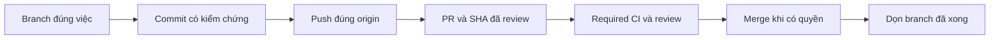

# Branch và PR: cách làm việc chung của Naqex

Mỗi repo có một nhánh chính do GitHub khai báo, thường là `main` hoặc `master`.
Một công việc dùng một branch ngắn hạn. Commit, push và merge là ba trạng thái
khác nhau. Quy trình source/docs này không cấp quyền deploy, release, migration
hoặc broker. Issue và AI metadata theo [README](README.md).

## Tên branch dễ hiểu

Codex tạo `codex/<viec-can-lam>`: chữ thường, không dấu, ngăn bằng dấu `-`.
Ưu tiên tiếng Việt không dấu trong repo cá nhân này; giữ thuật ngữ domain quen
thuộc như `mt5`, `api`, `prop` khi cần.

| Việc | Tên ví dụ |
|---|---|
| Sửa tính commission | `codex/sua-tinh-phi` |
| Kiểm dữ liệu EIA | `codex/kiem-du-lieu-eia` |
| Sửa tiếp tục lượt nghiên cứu | `codex/sua-khoi-phuc-nghien-cuu` |
| Cập nhật Git workflow | `codex/quy-trinh-github` |
| Cập nhật pin project | `codex/cap-nhat-phien-ban-project` |

Không dùng tên chung như `Nam`, `fix`, `task-2`, `completion` cho việc mới.
Không tạo branch theo từng tin nhắn, agent, lượt test hoặc commit. Tiếp tục
branch/PR đang mở khi cùng mục tiêu; việc độc lập dùng branch riêng. PR đã
merge kết thúc branch đó: công việc tiếp bắt đầu branch mới.

Cho phép tên dài hạn khi có consumer thật: ví dụ `codex/naqex-integration`
của Paperclip theo [integration guide](../integrations/README.md). Không đổi
tên upstream, Dependabot hoặc branch được runtime/tool tham chiếu chỉ để
đồng bộ hình thức. Branch cũ chưa xong có thể giữ tên kèm mục đích rõ trong PR.

## Trước khi sửa

Chạy trong repo sở hữu thay đổi; workspace và sản phẩm có Git/index riêng:

```powershell
git status --short
git branch -vv
git worktree list --porcelain
git remote -v
gh repo view --json nameWithOwner,defaultBranchRef
git fetch origin
```

Kiểm `origin` đúng nơi muốn ghi; `upstream` của fork thường chỉ đọc/cập nhật
nguồn. Kiểm HEAD, staged/unstaged, WIP và worktree owner; không reset/stash/
clean phần lane khác. Một checkout chỉ có một người tích hợp index/commit.

Branch mới bắt đầu từ nhánh chính đã fetch, hoặc base phụ thuộc được PLAN/PR
chỉ định. Không dùng local `main` cũ hay bỏ phần việc hiện tại để có branch
trông sạch. Lệch main lớn thì giữ source và tách đợt review hội nhập; không
tự merge hàng trăm commit để dọn tên. Rename branch đã chia sẻ cần kiểm PR,
worktrees, tracking và consumers; rename local không rename remote. Không
đổi tên default branch hàng loạt hoặc để tên cũ/mới trùng trên GitHub.

## Một vòng công việc



1. Review diff, stage đúng file, kiểm theo rủi ro và commit coherent. Đợt tồn
   lâu cần xem cả lịch sử chưa push. Không đưa secret, raw broker logs, media
   lớn hoặc cache bị ignore lên chỉ để “đủ bộ”.
2. Push branch cụ thể lên `origin`, không dùng `push --all`/mirror. Nhánh
   chính được bảo vệ → feature branch + PR; giữ protection và required checks.
   Không force-push lịch sử đã chia sẻ.
3. PR tập trung một mục tiêu; mô tả thay đổi/lý do/check/gaps và identity/
   reviewed SHA theo README. Commit mới cần review lại phần ảnh hưởng.
   Attach PR vào chat khi có công cụ hỗ trợ. Không gộp unrelated WIP.
4. Phân biệt CI chưa chạy/đang chạy/fail/pass. Fail thì đọc đúng log, sửa
   root cause hoặc ghi blocker; không bỏ test hợp lệ để pass.
   Secret scanner phải redact log. False positive cần kiểm đúng source và
   exact fingerprint; không ignore cả file/rule hoặc whitelist credential thật.
5. Merge theo quyền của task và checks bắt buộc. “Push” không tự là yêu cầu
   merge, nghiệm thu hay deploy; không bypass CI. Sau merge, fetch và cập
   nhật checkout bằng fast-forward khi sạch/đúng owner; dọn theo điều kiện dưới.

## Nhiều repo trong workspace

Commit/push repo con trước, rồi gitlink của workspace. Xác minh SHA con đã
có trên remote mà người clone truy cập được. Pin giữ commit cụ thể, không
tự thay theo branch HEAD. Thông thường: **PR sản phẩm → merge → PR pin**.
Nếu owner chỉ yêu cầu backup/push toàn bộ, có thể pin commit đang chờ PR,
nhưng phải báo rõ chưa merge/accepted. Không tự đổi `.gitmodules`, nâng pin
ngoài scope hoặc tạo commit cho upstream sạch. Checkout sạch khác mọi branch
đã merge. Với fork/source/runtime upgrades dùng skill `upstream-integrations`.

## Dọn branch sau khi xong

Cleanup phải nằm trong phạm vi được giao và đủ tất cả điều kiện:

- Là feature branch đã xong; không là default, integration, rollback anchor
  hoặc branch không rõ owner.
- Không checkout ở bất kỳ worktree nào, không worker/WIP đang dùng và không
  PR mở dùng làm head/base. Không xóa worktree chỉ để vượt điều kiện này.
- Fetch mới, tip đúng SHA đã review và vào **nhánh đích thật**. Kiểm bằng
  `git merge-base --is-ancestor <tip> origin/<base>`; không dùng một nhánh
  nghiên cứu khác làm bằng chứng đã vào main.
- Nếu xóa remote, tip remote vẫn đúng SHA đã kiểm và không có commit mới
  sau PR merge. Ghi ref/SHA trước khi xóa và kiểm trạng thái sau thao tác.

Dùng `git branch -d <branch>` cho local; remote chỉ xóa khi được giao cleanup
remote và đã qua các kiểm tra trên. Không delete theo wildcard hoặc dùng
`-D`/reset/rewrite để ép dọn. Squash/rebase merge có thể không khớp ancestry:
giữ lại để review patch/PR head cụ thể, không force-delete.

`branch -d` kiểm upstream đã cấu hình hoặc HEAD hiện tại. Nếu upstream cũ đã
mất mà branch được chứng minh nằm trong `origin/main`, có thể trỏ upstream
của đúng branch sắp xóa về nhánh đích đó rồi dùng lại `-d`. Không đổi upstream
để che commit chưa vào đích; ghi lại cả lần guard từ chối và bằng chứng ancestry.

PR cũ merged không đủ nếu branch đã được dùng tiếp. `fetch --prune` chỉ bỏ
remote-tracking refs đã mất trên server, không tự xóa branch GitHub. Auto-delete
head branches là setting riêng cần được giao, không tự bật trên mọi integration.

## Windows và báo cáo

Ref checkpoint có đường dẫn rất dài có thể bị báo broken trên Windows.
Kiểm `git -c core.longpaths=true for-each-ref` và `cat-file` trước khi kết
luận mất object; có thể dùng `-c core.longpaths=true` cho fetch/push của repo
bị ảnh hưởng. Không xóa `refs/codex/turn-diffs` hoặc đổi global config để né.

Báo ngắn theo repo: branch/mục đích, SHA đã push và đối soát remote, PR/CI,
merged hay chưa, WIP giữ lại và branch đã dọn/giữ vì sao. Git/GitHub là nguồn
trạng thái; receipt có ngày chỉ là evidence, không tạo tracker/daemon khác.

Đối chiếu 09/11/2026: [GitHub flow](https://docs.github.com/en/get-started/using-github/github-flow),
[protected branches](https://docs.github.com/en/repositories/configuring-branches-and-merges-in-your-repository/managing-protected-branches/about-protected-branches),
[git-branch](https://git-scm.com/docs/git-branch),
[git-worktree](https://git-scm.com/docs/git-worktree).
Tên tiếng Việt và thứ tự ghim submodule là convention của Naqex.
