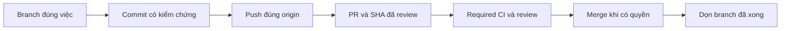

# Branch và PR: cách làm việc chung của Naqex

Mỗi repo có một nhánh chính do GitHub khai báo, thường là `main` hoặc `master`.
Một công việc dùng một branch ngắn hạn. Commit, push và merge là ba trạng thái
khác nhau. Quy trình source/docs này không cấp quyền deploy, release, migration
hoặc broker. Issue và AI metadata theo [README](README.md).

## Agent chọn sửa tại chỗ, branch hay worktree?

“Sửa trực tiếp” mặc định là sửa trên **branch công việc hiện tại**, không phải
push thẳng vào nhánh chính. Chọn theo mục tiêu, mức cô lập và người đang ghi:

| Tình huống | Cách làm |
|---|---|
| Sửa tiếp cùng task/PR: bug vừa phát hiện, CI, test, copy hoặc review feedback | Dùng tiếp branch/PR; không tạo branch vì sang lượt chat hoặc đổi agent |
| Chỉ đọc code, review, research chưa sửa file | Đọc source hiện có; chưa cần branch/worktree |
| Công việc độc lập, cần review/revert riêng hoặc thử hướng có thể bỏ | Branch mới từ đúng base; không trộn vào PR đang làm |
| Một agent làm tuần tự, checkout sạch và không có worker phụ thuộc source hiện tại | Branch mới có thể dùng cùng checkout; chưa cần thêm worktree |
| Nhiều agent thực sự ghi đồng thời hoặc cần giữ nguyên checkout có WIP/job đang dùng | Worktree riêng cho từng lane ghi độc lập, với ownership/path/output rõ |
| Các agent chỉ đọc hoặc một integrator lần lượt áp diff | Có thể dùng chung checkout; một người sở hữu index/commit, không branch mỗi agent |
| Sửa rất nhỏ khi đang ở main | Ưu tiên branch/PR ngắn; direct-main chỉ khi owner đã giao rõ, repo cho phép và checks vẫn đủ. Không dùng admin bypass |

Worktree cô lập file/index, không tự cô lập database, port, runtime, cache,
broker account hoặc output artifacts. Lane phải có path/state owner phù hợp;
không tạo nhiều worktree cùng ghi vào một job. Khi hội nhập các lane, review
diff và test chỗ giao nhau, không chỉ cộng các kết quả test riêng.

Nếu đọc/sửa file ở repo con, thực hiện Git ở repo con. Không lấy branch của
workspace để thay sự cô lập của project. Scope chưa đổi thì tiếp tục branch
đang dùng, kể cả công việc kéo dài; tách theo đợt có thể review khi scope lớn.

## Tên branch dễ hiểu

Codex tạo `codex/<short-task-name>` bằng tiếng Anh: chữ thường, ngăn bằng dấu
`-`, mô tả việc cụ thể. Dùng tên domain quen thuộc như `mt5`, `api`, `prop` khi
cần. Tên kỹ thuật thống nhất với code/GitHub; hướng dẫn và mô tả cho owner vẫn
ưu tiên tiếng Việt. Đây là convention của Naqex, không phải yêu cầu của Git.

| Việc | Tên ví dụ |
|---|---|
| Sửa tính commission | `codex/fix-commission` |
| Kiểm dữ liệu EIA | `codex/validate-eia-data` |
| Sửa tiếp tục lượt nghiên cứu | `codex/fix-research-resume` |
| Cập nhật Git workflow | `codex/github-workflow` |
| Cập nhật pin project | `codex/update-project-pins` |

Không dùng tên chung như `Nam`, `fix`, `task-2`, `completion` cho việc mới.
Không tạo branch theo từng tin nhắn, agent, lượt test hoặc commit. Tiếp tục
branch/PR đang mở khi cùng mục tiêu; việc độc lập dùng branch riêng. PR đã
merge kết thúc branch đó: công việc tiếp bắt đầu branch mới.

Cho phép tên dài hạn khi có consumer thật: ví dụ `codex/naqex-integration`
của Paperclip theo [integration guide](../integrations/README.md). Không đổi
tên upstream, Dependabot hoặc branch được runtime/tool tham chiếu chỉ để
đồng bộ hình thức. Branch cũ chưa xong có thể giữ tên kèm mục đích rõ trong PR.
Quy ước tiếng Anh áp dụng cho tên mới; không rename branch đã chia sẻ chỉ để
đổi ngôn ngữ khi còn PR, worktree hoặc consumer. Khép PR/dọn ref cũ theo gate
bên dưới, rồi đặt tên tiếng Anh cho công việc mới.

## Trước khi sửa

Chạy trong repo sở hữu thay đổi; workspace và sản phẩm có Git/index riêng:

```powershell
git status --short
git branch -vv
git worktree list --porcelain
git remote -v
gh repo view --json nameWithOwner,defaultBranchRef
git fetch origin
```

Kiểm `origin` đúng nơi muốn ghi; `upstream` của fork thường chỉ đọc/cập nhật
nguồn. Kiểm HEAD, staged/unstaged, WIP và worktree owner; không reset/stash/
clean phần lane khác. Một checkout chỉ có một người tích hợp index/commit.

Branch mới bắt đầu từ nhánh chính đã fetch, hoặc base phụ thuộc được PLAN/PR
chỉ định. Không dùng local `main` cũ hay bỏ phần việc hiện tại để có branch
trông sạch. Lệch main lớn thì giữ source và tách đợt review hội nhập; không
tự merge hàng trăm commit để dọn tên. Rename branch đã chia sẻ cần kiểm PR,
worktrees, tracking và consumers; rename local không rename remote. Không
đổi tên default branch hàng loạt hoặc để tên cũ/mới trùng trên GitHub.

Với worktree tạo từ submodule, kiểm `git rev-parse --show-toplevel` khớp đường
dẫn checkout trước khi stage/cleanup. `core.worktree` tương đối được kế thừa có
thể khiến Git nhìn nhầm thư mục metadata và báo hàng loạt file bị xóa. Xác minh
config origin; sửa `core.worktree` bằng `git config --worktree` chỉ cho checkout
mới khi đã bật `extensions.worktreeConfig`, rồi kiểm lại source/worktree. Không
stage danh sách xóa giả hoặc đổi shared/global config để chữa checkout khác.

## Một vòng công việc



1. Review diff, stage đúng file, kiểm theo rủi ro và commit coherent. Đợt tồn
   lâu cần xem cả lịch sử chưa push. Không đưa secret, raw broker logs, media
   lớn hoặc cache bị ignore lên chỉ để “đủ bộ”.
2. Push branch cụ thể lên `origin`, không dùng `push --all`/mirror. Nhánh
   chính được bảo vệ → feature branch + PR; giữ protection và required checks.
   Không force-push lịch sử đã chia sẻ.
3. PR tập trung một mục tiêu; mô tả thay đổi/lý do/check/gaps và identity/
   reviewed SHA theo README. Commit mới cần review lại phần ảnh hưởng.
   Attach PR vào chat khi có công cụ hỗ trợ. Không gộp unrelated WIP.
4. Phân biệt CI chưa chạy/đang chạy/fail/pass. Fail thì đọc đúng log, sửa
   root cause hoặc ghi blocker; không bỏ test hợp lệ để pass.
   Secret scanner phải redact log. False positive cần kiểm đúng source và
   exact fingerprint; không ignore cả file/rule hoặc whitelist credential thật.
5. Merge theo quyền của task và checks bắt buộc. “Push” không tự là yêu cầu
   merge, nghiệm thu hay deploy; không bypass CI. Sau merge, fetch và cập
   nhật checkout bằng fast-forward khi sạch/đúng owner; dọn theo điều kiện dưới.

## Khi nào nên gộp?

Gộp khi một lát thay đổi coherent đã xong: diff đúng scope, source/các interface
đã review, checks bắt buộc đạt trên **đúng HEAD**, không conflict/material bug
chưa giải quyết, dependency đã vào đúng base và task có quyền merge. Pin lại
head SHA trước thao tác; HEAD/CI đổi thì kiểm lại phần bị ảnh hưởng.

Không đợi toàn bộ Goal nghiên cứu hay cả sản phẩm hoàn tất mới gộp từng lát.
Ngược lại, CI xanh không thay evidence của hành vi, scope, migration hoặc
quyền merge. Những việc còn dang dở không bị gọi là hoàn thành để giảm branch.
PR phụ thuộc gộp vào base đã chỉ định; gộp vào branch trung gian chưa là vào main.

Nếu chưa có quyền merge từ lần giao trước, owner chỉ hỏi “có nên gộp?” thì
đưa đề xuất cụ thể với PR/SHA/gates, không tự biến câu hỏi thành quyền merge.
Khi đã được giao trọn vòng triển khai–merge,
agent tự làm khi đủ điều kiện, không hỏi lại cho từng commit/PR cùng phạm vi.

## Nhiều repo trong workspace

Commit/push repo con trước, rồi gitlink của workspace. Xác minh SHA con đã
có trên remote mà người clone truy cập được. Pin giữ commit cụ thể, không
tự thay theo branch HEAD. Thông thường: **PR sản phẩm → merge → PR pin**.
Nếu owner chỉ yêu cầu backup/push toàn bộ, có thể pin commit đang chờ PR,
nhưng phải báo rõ chưa merge/accepted. Không tự đổi `.gitmodules`, nâng pin
ngoài scope hoặc tạo commit cho upstream sạch. Checkout sạch khác mọi branch
đã merge. Với fork/source/runtime upgrades dùng skill `upstream-integrations`.

## Dọn branch sau khi xong

Cleanup phải nằm trong phạm vi được giao và đủ tất cả điều kiện:

- Là feature branch đã xong; không là default, integration, rollback anchor
  hoặc branch không rõ owner.
- Không checkout ở bất kỳ worktree nào, không worker/WIP đang dùng và không
  PR mở dùng làm head/base. Không xóa worktree chỉ để vượt điều kiện này.
- Fetch mới, tip đúng SHA đã review và vào **nhánh đích thật**. Kiểm bằng
  `git merge-base --is-ancestor <tip> origin/<base>`; không dùng một nhánh
  nghiên cứu khác làm bằng chứng đã vào main.
- Nếu xóa remote, tip remote vẫn đúng SHA đã kiểm và không có commit mới
  sau PR merge. Ghi ref/SHA trước khi xóa và kiểm trạng thái sau thao tác.

Dùng `git branch -d <branch>` cho local; remote chỉ xóa khi được giao cleanup
remote và đã qua các kiểm tra trên. Không delete theo wildcard hoặc dùng
`-D`/reset/rewrite để ép dọn. Squash/rebase merge có thể không khớp ancestry:
giữ lại để review patch/PR head cụ thể, không force-delete.

`branch -d` kiểm upstream đã cấu hình hoặc HEAD hiện tại. Nếu upstream cũ đã
mất mà branch được chứng minh nằm trong `origin/main`, có thể trỏ upstream
của đúng branch sắp xóa về nhánh đích đó rồi dùng lại `-d`. Không đổi upstream
để che commit chưa vào đích; ghi lại cả lần guard từ chối và bằng chứng ancestry.

PR cũ merged không đủ nếu branch đã được dùng tiếp. `fetch --prune` chỉ bỏ
remote-tracking refs đã mất trên server, không tự xóa branch GitHub. Auto-delete
head branches là setting riêng cần được giao, không tự bật trên mọi integration.

## Agent tự khép việc sau merge

Trong phạm vi merge/cleanup owner đã giao, bước này là phần mặc định của
skill GitHub, agent tự thực hiện khi khép task, không chờ owner nhắc:

1. Đọc lại kết quả merge từ GitHub: head SHA đã merge, base và merge SHA.
   Fetch base, kiểm source đã vào đúng đích; đừng chỉ dùng exit0 của lệnh merge.
2. Kiểm mọi worktree/worker/WIP và PR head/base phụ thuộc như cửa cleanup ở
   trên. Với checkout sạch của chính lane, chỉ chuyển về base sau khi xác minh
   không còn consumer cần source cũ. Lane khác đang dùng thì giữ branch và ghi lý do.
3. Dọn ref local/remote đúng tip khi đủ điều kiện; ghi tên/SHA và kết quả.
   Không force-delete, xóa worktree đang dùng hoặc sửa dữ liệu/runtime để ép dọn.
4. Khi repo con thay đổi, đối chiếu pin workspace theo đích đã giao; commit/PR
   pin riêng nếu cần. Không tự nâng dependency khác hoặc reset pin theo main mới.
5. Báo task đã merge vào đâu, checkout/PR/branch nào được giữ, việc còn lại.
   Branch được giữ vì consumer không làm task mất kết quả đã nghiệm thu.

Đây là tự động trong lượt agent có quyền làm Git, không job định kỳ tự quét
repo khi không có agent. Reuse skill hiện có; chưa cần skill/daemon chuyên
“xóa branch cũ”. Không tự bật auto-delete của GitHub trên toàn bộ repo: setting
đó không kiểm các worktree và consumers local như quy trình này.

## Windows và báo cáo

Ref checkpoint có đường dẫn rất dài có thể bị báo broken trên Windows.
Kiểm `git -c core.longpaths=true for-each-ref` và `cat-file` trước khi kết
luận mất object; có thể dùng `-c core.longpaths=true` cho fetch/push của repo
bị ảnh hưởng. Không xóa `refs/codex/turn-diffs` hoặc đổi global config để né.

Báo ngắn theo repo: branch/mục đích, SHA đã push và đối soát remote, PR/CI,
merged hay chưa, WIP giữ lại và branch đã dọn/giữ vì sao. Git/GitHub là nguồn
trạng thái; receipt có ngày chỉ là evidence, không tạo tracker/daemon khác.

Đối chiếu 09/11/2026: [GitHub flow](https://docs.github.com/en/get-started/using-github/github-flow),
[protected branches](https://docs.github.com/en/repositories/configuring-branches-and-merges-in-your-repository/managing-protected-branches/about-protected-branches),
[git-branch](https://git-scm.com/docs/git-branch),
[git-worktree](https://git-scm.com/docs/git-worktree).
Tên branch tiếng Anh và thứ tự ghim submodule là convention của Naqex.
