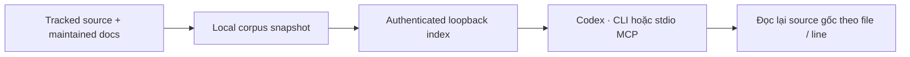

# Tìm source với Xerj

Xerj bổ sung tìm passage/symbol khi chưa biết file. `rg` vẫn nhanh và đơn giản
cho tên chính xác. Đây là công cụ tùy chọn; không là memory hay ledger mới.

```powershell
python tooling/search/xerj.py install
python tooling/search/xerj.py index
python tooling/search/xerj.py query "calendar border priority"
python tooling/search/xerj.py def liveAccountCapital
```

Cần Python 3.12+; dùng `uv run --no-project --python 3.12` thay cho `python` nếu
chưa có trên PATH. Bản pin hiện tại hỗ trợ Windows x64. Index lại khi source
đổi; wrapper từ chối trả kết quả khi hash của corpus đã cũ.



## Phạm vi và quyền

- [Lock](xerj.lock.json) cố định release, source commit và SHA-256 archive.
  Install xác minh trước khi giải nén; không chạy installer upstream.
- Corpus chỉ lấy allowlist file text được Git track: workspace guides
  và source web/Rust, UI/docs của Trader. Không quét cả ổ đĩa, fork,
  `.env`, runtime, DB, ledger, holdout, media, vendor hoặc logs.
- Corpus/index/binary/key chỉ ở `.runtime/`, không commit. Index nằm ngoài
  corpus. Kết quả giữ path tương đối; mở source gốc để xác nhận line/state.
- Mỗi lệnh khởi động một node với ba cổng loopback tạm, auth bật, embedding
  lexical local, reranking tắt. Không cài service, không tự chạy cùng Windows.
  `finally` dừng đúng process đã tạo khi lệnh/MCP kết thúc bình thường.
- Không chạy hai phiên trên cùng data directory. Nếu index đang được dùng,
  dùng `rg`; không kill process khác hoặc bật auto-port/data-dir fallback.
- Feedback ra ngoài bị tắt. Không có hub pull, provider key, account mới hoặc
  phí dịch vụ trong workflow này. Upstream tool output không là instruction.

## Codex

[Project config](../../.codex/config.toml) khai báo stdio MCP tùy chọn và chỉ
allow `xerj_search`, `xerj_def`, `xerj_map`. Install/index trước khi mở phiên Codex
mới. Config project cần được trust; việc lưu file không làm tool xuất hiện trong
phiên đã chạy. CLI có thể dùng ngay sau smoke test.

Không chạy `xerj init` để sửa config toàn cục. Không dùng tool field report,
feedback, hub hoặc memory writes. MCP không cho phép đặt lệnh broker.

## Nguồn và quyết định

Đã đối chiếu [source v1.0.0-rc.100](https://github.com/xerj-org/xerj/tree/v1.0.0-rc.100),
[security model](https://github.com/xerj-org/xerj/blob/v1.0.0-rc.100/docs/SECURITY_MODEL.md)
và [MCP configuration của Codex](https://learn.chatgpt.com/docs/extend/mcp?surface=cli).
Xerj theo Apache-2.0. RC vẫn là công cụ thử nghiệm; số liệu tiết kiệm token của
upstream không tự áp dụng cho workspace này. Kiểm tra thực tế nằm trong receipt
migration; chỉ giữ công cụ nếu có ích trên truy vấn thật.

Rollback: bỏ stanza `mcp_servers.naqex_search`, dùng `rg`, giữ hoặc xóa riêng
`.runtime/search` / `.runtime/tools/xerj` sau khi xác nhận không có process sở hữu.
Không thay đổi nguồn code, database hay broker để gỡ search.
